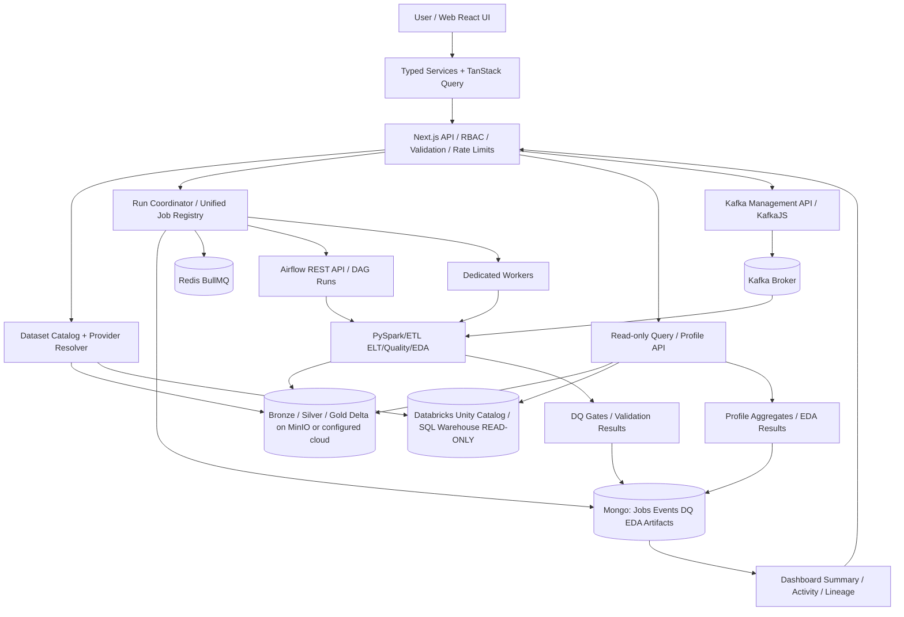
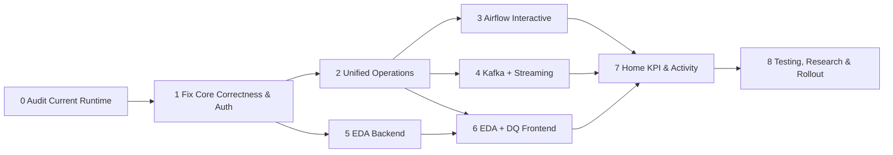

# MASTER IMPLEMENTATION PLAN — INTERACTIVE DATA LAKEHOUSE CONTROL PLANE, AIRFLOW, KAFKA, EDA & DATA QUALITY

> **Đề tài:** Xây dựng Data Lakehouse cho dữ liệu bán hàng bằng quy trình ETL và ELT  
> **Ngày baseline:** 24/10/2026  
> **Loại tài liệu:** Kế hoạch kiến trúc, tích hợp mã nguồn, UI/UX, API, xử lý dữ liệu, kiểm thử và nghiệm thu. **Không phải báo cáo tính năng đã được triển khai.**  
> **Nguồn baseline:** ZIP `data-lake-architure-cloude(20261024-105920).zip`; bốn screenshots 20:04–20:06; `machine_learning_pipeline&rule(1).md`; API inventory do Project Owner cung cấp; source code được đọc tĩnh.  
> **Mức xác minh:** `SOURCE VERIFIED (ZIP 24/10)` cho những file được trích dẫn; `USER-SHOWN RUNTIME (SCREENSHOTS)` cho trạng thái hiển thị; `PROPOSED` cho thành phần mới; `RUNTIME UNVERIFIED` đối với backend sau những thay đổi Kafka gần đây.  
> **Ràng buộc:** Giữ kiến trúc dự án và design system hiện hữu, không tạo số liệu giả; ưu tiên tái sử dụng source, tích hợp incremental, bảo mật và đảm bảo tính đúng đắn khoa học.  
> **Quan trọng:** Plan đã kiểm tra đối chiếu source trong ZIP nhưng **không** khẳng định đã kiểm chứng checkout mới nhất đang chạy, và **không** tiến hành triển khai/sửa code trong repository.

---

## 00. EXECUTIVE DECISION — PHẠM VI, MỤC TIÊU, ĐỊNH NGHĨA HOÀN THÀNH

### 00.1. Định nghĩa sản phẩm đích

Biến web hiện nay từ *Data Lakehouse monitoring / metadata dashboard* thành một **Interactive Data Operations Control Plane** có thể: (1) khám phá dataset và nguồn; (2) cấu hình/chạy/quan sát/retry/cancel jobs theo quyền hạn; (3) tạo, xem, produce và inspect Kafka streams; (4) điều khiển Airflow DAG/runs, xem task logs; (5) chạy quy trình Bronze → Silver → Gold; (6) khám phá dữ liệu bằng EDA có provenance; (7) định nghĩa/chạy Data Quality rules, suite và quality gates; (8) xem kết quả job, data lineage, DQ và EDA trên UI; (9) tổng hợp Home KPI từ nguồn đã xác minh.

### 00.2. Hai nhiệm vụ trong trang **Data Quality**

- **EDA / Data Profiling:** quan sát, mô tả, trực quan hóa cấu trúc/phân phối/quan hệ dữ liệu, phát hiện vấn đề, phân tích các biến thể *theo nguồn dữ liệu, bảng, layer, phiên bản và từng bước xử lý*. EDA là **read-only**; không tự động sửa dữ liệu.
- **Data Quality Evaluation / Governance:** khai báo rule, chạy validation suites, ghi bằng chứng, so sánh quality trước/sau transform, yêu cầu đạt quality gate trước publish Silver/Gold; có trạng thái pass/fail/error/not-evaluated và audit.

Không đồng nhất EDA với DQ; không biến trang Data Quality thành ML model training suite ngay ở MVP. Các kiến thức feature engineering/split/metrics từ tài liệu ML dùng để diễn giải EDA và hỗ trợ **future ML readiness**, không áp dụng vô điều kiện cho giám sát ETL/ELT.

### 00.3. Mức nghiệm thu

- **100% acceptance gates P0 PASS** trên môi trường tích hợp được phép; không còn blocker đã biết về correctness/data safety/security của luồng yêu cầu; có evidence, log, phiên bản source/data; regression PASS. Không hứa hệ thống không bao giờ có lỗi.
- `IMPLEMENTED` nghĩa có source; `STATIC VERIFIED` nghĩa đọc và cross-check; `INTEGRATION VERIFIED` nghĩa test chạy thật; `PRODUCTION VERIFIED` chỉ khi có bằng chứng ở môi trường mục tiêu. Tính năng `PROPOSED` không được tô xanh trên UI.

### 00.4. Đề xuất giải pháp tối ưu

**Giữ Next.js API như Control Plane; dùng Airflow làm orchestration cho các DAG/pipeline dài; dùng Spark/Python xử lý ETL/ELT, DQ và EDA lớn; dùng Kafka cho dữ liệu stream; dùng Mongo/Redis làm metadata, job status, event/outbox; dùng DuckDB hoặc Databricks SQL read-only làm query/aggregation engine theo provider; lưu profile/DQ results có snapshot; React Query hiển thị job progress, trạng thái và biểu đồ.**

Không được cho web gọi trực tiếp Kafka broker, Airflow, MinIO, Databricks token, Spark subprocess hoặc arbitrary SQL từ client.

---

## 01. BẢNG ĐỐI CHIẾU ẢNH, TÀI LIỆU VÀ SOURCE CODE

| Thành phần | Bằng chứng ảnh 24/10 | Source đã kiểm tra | Kết luận & khoảng trống |
|---|---|---|---|
| Home | Databricks workspace, tổng 13 bảng; Running Jobs 0; Active Topics 0; Active DAGs 0; Records/Quality `—`; Activity `0 events` | `apps/web/src/screens/home/home.view.tsx:42-75`, `home.constants.ts`, `apps/web/src/services/queries/home.queries.ts:20-52` | 8 request riêng `allSettled`, `HOME_ACTIVITY=[]`, cần KPI semantics + event feed thống nhất |
| Kafka | 1 broker, không còn connection error, 0 topics và 0 groups | `apps/web/src/screens/kafka/kafka.view.tsx`; Kafka controllers/repository; `docker-compose-kafka.yml` | Đây là dấu hiệu **kết nối trong ảnh**, KHÔNG phải chứng nhận produce→consume, Stream→Bronze hay trạng thái ổn định nhiều giờ |
| Airflow | Một DAG `retail_elt_dag`, paused; chưa có runs | `airflow_dags/` có 4 DAG definitions; `apps/web/src/screens/airflow/airflow.view.tsx`, API Airflow repository | Cần kiểm tra DAG import errors, scheduler/discovery filters và version actual. Paused không đồng nghĩa lỗi; cần preflight trước trigger |
| DQ | 0 rules, 0 runs; status unknown | `apps/web/src/screens/dq/dq.view.tsx`; `apps/api/src/modules/dq/services/dq.service.ts` + `executors/dq.executor.ts` | Có CRUD, presets, execution; thiếu data selection + apply preset/EDA + safe job orchestration; engine còn lỗi logic cần sửa |
| Catalog | Home có 13 bảng Databricks | `apps/api/src/modules/catalog/repositories/databricks.repository.ts`; `apps/api/src/lib/infra/databricks/client.ts` | Databricks catalog là **read-only provider** trong source hiện tại; không được cho nút mutation tự ghi remote |
| Bronze | Có UI, API và job queue nhưng chưa có bằng chứng job thành công | `apps/api/src/modules/bronze/workers/bronze-executors.ts:3-16` | Ba executors CSV/JSON/stream đều `throw not implemented` trong ZIP — blocker vận hành |
| Silver/Gold | Có UI/forms/routes/queues | `apps/api/src/modules/{silver,gold}/workers/`; DuckDB repositories | Cần xác minh đọc đúng Delta, transform/aggregation thực và worker startup |

### 01.1. Các kết luận đặc biệt không được bỏ qua

1. **Databricks và MinIO không tự động là một kho dữ liệu thống nhất.** `apps/api/src/lib/infra/databricks/client.ts:87-89` định nghĩa `remoteReadOnly()` và chặn mutation khi `LAKEHOUSE_DATA_SOURCE=databricks`. Spark/MinIO pipelines hiện có storage semantics riêng. Tất cả màn hình và hành động phải hiển thị `provider`, `datasetId`, `executionTarget`, `dataVersion`.
2. **Home KPI hiện sai/thiếu semantic**: `home.queries.ts:36-37` đặt `records24h=null` khi thấy Databricks, ở nguồn khác lại cộng bản ghi Bronze+Silver+Gold dễ double count. Screenshot ghi "Records Processed (all time)" nhưng field code là `records24h`: xác định lại KPI chính thức trước implementation.
3. **Worker launcher chưa đầy đủ**: `apps/api/src/workers/main.ts:21-25` chỉ khởi động `CrawlerWorkerManager`, chưa gọi `BronzeWorkerManager`, `SilverWorkerManager`, `GoldWorkerManager`. Không suy ra workers hoàn toàn không thể khởi động bằng entry point khác khi chưa kiểm runtime, nhưng phải có deployment proof cho mỗi queue.
4. **DQ hard-coded path**: `apps/api/src/modules/dq/executors/dq.executor.ts:5-13` dựng `s3://lakehouse/{layer}/{table}`; Python `src/lakehouse/core/paths.py` dựng bucket theo Bronze/Silver/Gold; Catalog Databricks lại là third-party namespace. Bắt buộc tập trung vào `DatasetResolver` theo provider thay vì copy path qua module.
5. **DQ execution bugs**: `dq.executor.ts:105` gọi sample `WHERE IS NULL` thiếu cột; `finally` ở các rule handlers đang trống, không đóng DuckDB connection; `custom_sql` chỉ blacklist keywords, chưa có SQL parser/allowlist đầy đủ; `unique` không tính null như một duplicate (phải ghi rõ null kiểm bằng rule riêng); `DqSummaryService.summary():316` trả passRate=1 khi chưa có run, dù FE adapter đổi về null; phải fix tại contract để không có tín hiệu chất lượng giả.
6. **DQ suite synchronous**: `dq.service.ts:154-180` chạy từng rule nối tiếp ngay trong request; không có queue cho long-running scans. Cần chuyển workflow mới sang `202 Accepted` và job status, có thể giữ endpoint legacy tương thích nếu an toàn.
7. **Airflow DAG có `docker exec`**: `airflow_dags/retail_elt_dag.py` gọi `docker exec lake-spark-master spark-submit`; `docker-compose.yml` mount `/var/run/docker.sock` vào scheduler/webserver. Đây là đường cần siết bảo mật; cân nhắc SparkSubmitOperator/remote submit/isolated runner thay vì cấp quyền Docker socket dài hạn.
8. **Không có sample retail data trong ZIP root**: DAG yêu cầu các file `data-samples/`; nếu source không tồn tại ở runtime, trigger sẽ fail dù UI/airflow healthy. Phải kiểm preflight và có sample/test fixtures tách biệt dữ liệu thật.
9. **Airflow 4 DAG ở source, screenshot 1 DAG**: so sánh `airflow dags list`, import errors, scheduler logs, volume mounts, CLI view, chỉ triển khai những DAG hỗ trợ và đủ deps. Không tự biến trạng thái paused thành active.
10. **Ảnh Kafka 0 topic**: được phép hiển thị 0 nếu query thực sự trả danh sách rỗng; không tự tạo topic thực nghiệm vào Kafka production chỉ để điền KPI.

### 01.2. Luồng ML/EDA từ tài liệu được giữ và hiệu chỉnh

`machine_learning_pipeline&rule(1).md` nhấn mạnh: xác định câu hỏi/5W1H → khảo sát cấu trúc N×D → histogram/KDE → correlation/multivariate → missing/outlier/duplicate → feature/data processing → lưu log/giả thuyết/so sánh baseline. Bổ sung nguồn trong chính file: cảnh báo correlation không đồng nghĩa phụ thuộc phi tuyến; chọn imputation theo phân phối; IQR/outlier; chống leakage khi huấn luyện; kiểm soát phiên bản và dữ liệu; experiment log.

**Ranh giới khoa học:** (i) L1/L2 regularization **không** phải thuật toán xóa outlier; (ii) ROC, PR và R² là metrics **đánh giá mô hình** chứ không phải đồ thị EDA thô; (iii) quy tắc `fit on train only` áp dụng khi EDA/transform phục vụ selection/tuning mô hình, trong khi quality monitoring mô tả toàn bộ production dataset có thể xem toàn bảng theo phạm vi được ủy quyền; (iv) data leakage cần xét theo role và mục đích sử dụng; (v) p-value so với alpha định trước (thường 0.05), không so với 0.5; (vi) EDA không tự động ra quyết định loại dòng hoặc tạo mô hình.

---

## 02. KIẾN TRÚC MỤC TIÊU & RANH GIỚI QUYỀN SỞ HỮU



Các mũi tên chỉ kiến trúc **PROPOSED** hoặc integration boundary có source tham chiếu, không khẳng định đã chạy end-to-end.

### 02.1. Single-Owner Principle

| Capability | Owner | Không được làm |
|---|---|---|
| Catalog, source/provider identity | Catalog + `DatasetResolver` | UI ghép string `s3://` hoặc giả định databricks = MinIO |
| Workflow orchestration đa stage, schedules | Airflow | Tạo hai scheduler riêng cho cùng job |
| One-off bounded background tasks | BullMQ **hoặc** Airflow (quy tắc dispatch rõ) | Run duplicate hai engine, double execution |
| Streaming execution | Spark Structured Streaming / dedicated consumer runner | HTTP request giữ sống stream vô hạn |
| Topic/message/broker control | KafkaJS Backend | Browser mở trực tiếp Kafka socket |
| DQ rules, suites, gates | DQ domain service & executor | FE quyết định PASS/FAIL từ số liệu mẫu |
| EDA profiles & chart aggregates | Profile/EDA service, provider-specific query executor | Browser tải toàn bộ hàng triệu dòng hoặc fit model trong React |
| Run lifecycle / progress | Unified Job Registry | Home tính job bằng tổng state rời rạc không dedupe |
| Observability/activity | Event ledger + metrics projections | Activity feed hard-code demos |
| Analytics charts | FE chart renderer từ typed series | Backend trả HTML/JS biểu đồ không kiểm soát |

### 02.2. Providers và execution targets

| Source | Read | EDA | DQ | Mutate ETL/ELT | Điều kiện |
|---|---|---|---|---|---|
| `local_delta_minio` | DuckDB/Delta | DuckDB + Spark job | DuckDB/Spark | Spark/Airflow local | Fix path resolver, credentials, writer, transactions |
| `databricks_uc` | Unity Catalog + SQL Warehouse | Pushdown SQL bounded hoặc async remote query | Chỉ read-only validation query có quyền | **Không** ở source hiện tại | Cần tích hợp *riêng* Databricks Jobs/Workflows với permission, auth, quota, runtime proof trước khi bật mutation |
| `kafka_topic` | Bounded inspector/consumer | Event/window profile | Schema/contract/event DQ | Publish theo quyền; stream ingestion qua Spark | Bounded offsets/time window, không lấy toàn topic vô hạn |
| `uploaded_fixture` | Validated sandbox import | EDA/DQ trên staging | Có | Chỉ theo job và target được cấp phép | Không ghi đè dataset production |

Provider contract đề xuất: `DatasetRef { provider, catalog?, schema?, layer?, database?, table, tableId, deltaVersion?, asOf?, kafkaTopic?, partition?, dataAccessMode }`. `StorageResolver` trả path nội bộ từ catalog, không nhận arbitrary URL/bucket từ user khi ghi hoặc chạy SQL.

---

## 03. THIẾT KẾ WORKFLOW E2E — TỪ CLICK ĐẾN KẾT QUẢ

### 03.1. Tổng luồng tối ưu (interactive but asynchronous)

1. User chọn dataset/source + hành động từ UI.
2. Frontend hiển thị *preflight*: provider, executionTarget, available data, expected side effects, permissions, resources/cost, DAG paused state, Kafka topic, DQ policies.
3. User xác nhận; React service gửi typed mutation kèm `Idempotency-Key`, `traceId` hoặc `clientRequestId`.
4. API xác thực/ủy quyền theo role, Zod-validate, kiểm environment/provider, quota, upstream health, collision risk và argument allowlists; **không** thực thi code SQL tùy tiện.
5. Coordinator tạo canonical `operationId`, `RunRecord` và event `queued` bằng idempotent write; dispatch đến Airflow hoặc dedicated worker **một lần**.
6. Worker/Airflow thực thi từng stage, cập nhật progress và run-specific logs, checkpoint, input/output Delta versions, row counts, affected tables, DQ checks.
7. Sau mỗi stage, persist result, emit `RunEvent` (started/progress/succeeded/failed/cancelRequested/cancelled). DQ gates theo stage có thể chặn publish hoặc đánh dấu warning tùy policy.
8. FE theo dõi `/operations/{id}` bằng adaptive polling (MVP) hoặc SSE (phase sau); status có correlation links qua Airflow `dagRunId`, BullMQ job, Dataset snapshot.
9. Khi finished, invalidate query keys theo dataset/layer + refresh Catalog, Kafka, DQ, Home, Activity; có entry trong Run History, provenance và đường mở EDA profile.
10. Job `failed/partial/timeout` có recovery/retry chính xác theo idempotency; **không** tự tạo Success event.

### 03.2. User journey số 1 — Kafka → Stream → Bronze → DQ → EDA

- `Kafka Streaming` → chọn topic → inspect schema/messages (bounded), xem lag và consumer-group state → `Start Ingestion`.
- Wizard xác định topic, consumer group, deserialization schema, storage target, start policy, max batches/duration, checkpoint path, `runMode=bounded|continuous`, permissions.
- API preflight bảo đảm topic exists, Spark worker available, bucket write/read, quota; tạo `streamingOperationId` và dispatch vào approved worker/Airflow.
- Spark Structured Streaming đọc Kafka theo schema, kiểm tra malformed events + checkpoint độc lập; ghi **Bronze** với ingestion metadata (`event_ts`, `ingest_ts`, source topic, partition, offset, batchId).
- Bảng Bronze xuất hiện trong Catalog sau sync; DQ preflight profile và rule suite; UI timeline minh họa `Kafka → Bronze → EDA → DQ`, có dead-letter/invalid-record route nếu thiết kế hỗ trợ.
- Không dùng route `GET messages` như consumer production; đây là bounded inspection, không quản lý offset của streaming job.
- Stop stream có `stop requested → graceful termination → checkpoint persisted → stopped`, không chỉ xóa job trong Mongo.

### 03.3. User journey số 2 — Airflow → Batch Retail ELT → Gold

- Chọn DAG (vd `retail_elt_dag`), xem paused/manual, import status, schema `conf`, input paths, prerequisites, downstream impacts.
- `Run once` **không bắt buộc Unpause** đối với manual DAG nếu API Airflow hỗ trợ; nút riêng `Enable schedule` cho DAG có lịch.
- Trigger có `runId` duy nhất, clientRequestId/idempotency, DAG conf đã validate/allowlist, hiển thị confirmation. Nếu input retail chưa tồn tại, preflight fail rõ ràng.
- Timeline: `health_check → Bronze(customers/products/orders) → Silver → Gold` với task states, logs, duration, retries, output tables/versions; phân biệt `RUNNING` với `DAG SCHEDULE ACTIVE`.
- Sau Gold: DQ suite Gold → profile/EDA snapshot → refresh Catalog → Home job ledger/activity. Những bước DQ/EDA thêm vào DAG phải có owner, dependency và fail policy được xác nhận.
- Khi dùng Databricks provider, không biến trigger DAG MinIO thành mutation lên 13 bảng Databricks; phải chọn executionTarget local hoặc remote pipeline được triển khai thật.

### 03.4. User journey số 3 — Dataset → EDA → Quality rules → Comparison

- `Data Quality` → `Explore Data` → dataset picker (provider, layer, table, snapshot/version, source and columns) → `Run Profile`.
- Backend trả `202` với `profileId`; query engine tính thống kê tổng, per-column/missing, distribution, categorical, temporal và correlation theo rule ngân sách; persist result với provenance, sample frame, elapsed/cost/errors.
- FE chart templates chỉ bật khi datatype/metric phù hợp; show n, missing, denominator, sample policy, filters, Delta version, null treatment, warning, precision.
- `Create Rule from Finding` prefill form (vd email null > threshold), không tự tạo rule bất ngờ; lưu rule + version + reason.
- `Run Rule/Suite`: engine đọc **cùng datasetVersion** đã profile, lưu failures/quality decision; chọn `Compare Bronze vs Silver`, `Before/After`, `Drift`.
- Không tự xóa outliers/duplicates; transform proposals sang Silver phải là thay đổi độc lập có confirm, test và lineage.

### 03.5. User journey số 4 — Home → Drill-down

- Home hiện `Running Jobs`, `Active Topics`, `Active DAGs`, `Records Processed (all time)` và `Quality Pass Rate` từ một summary có metadata: `asOf`, `source`, `window`, `coverage`, `staleness`.
- Click số liệu tới danh sách được filter: jobs currently running; Kafka topics; unpaused DAGs; processed records; DQ latest-runs.
- Activity feed hiển thị event thật theo correlation IDs; mỗi dòng có actor, timestamp, source, stage, status, datasetRef, click mở detail.
- `0` chỉ khi query thành công và tập đã được kiểm tra rỗng; unavailable => `—`; no evaluated data => `Not evaluated`; partial provider => `Partial`.

---

## 04. JOB STATE, PROVENANCE, RELIABILITY & OBSERVABILITY

### 04.1. `RunRecord` canonical schema — PROPOSED

```ts
interface RunRecord {
  operationId: string; idempotencyKey: string; traceId: string;
  kind: 'batch_ingest'|'stream_ingest'|'transform'|'aggregate'|'airflow_dag'|'dq_rule'|'dq_suite'|'eda_profile'|'crawler';
  executionEngine: 'airflow'|'bullmq'|'spark'|'databricks_job';
  executionTarget: 'local_delta_minio'|'databricks_uc'|'kafka_topic';
  sourceDatasetIds: string[]; targetDatasetIds: string[];
  status: 'queued'|'preflight_failed'|'running'|'cancel_requested'|'cancelling'|'cancelled'|'succeeded'|'failed'|'timed_out'|'partial';
  externalJobId?: string; airflowDagId?: string; airflowRunId?: string;
  actorId: string; createdAt: string; startedAt?: string; finishedAt?: string; heartbeatAt?: string;
  progress?: { stage: string; completedUnits?: number; totalUnits?: number; fraction?: number };
  metrics?: { recordsInput?: string; recordsOutput?: string; rejectedRecords?: string; bytesRead?: string; bytesWritten?: string };
  dataSnapshots?: Array<{datasetId: string; deltaVersion?: number; commitId?: string; asOf?: string}>;
  qualityGate?: { outcome: 'pass'|'fail'|'warn'|'error'|'not_evaluated'; dqRunId?: string };
  error?: { code: string; safeMessage: string; retryable: boolean };
  createdBy?: 'ui'|'api'|'schedule'|'system'; updatedAt: string;
}
```

- Record count dưới dạng decimal string để tránh JS overflow; canonical one `operationId` across systems, external IDs là cross-links. Timestamps ISO-8601 UTC, frontend localized.
- Atomic/idempotent operation create và side-effect dispatch bằng outbox/transaction boundary phù hợp; reconciliation worker kiểm states bị kẹt và đối chiếu Airflow/BullMQ, không chỉ `setTimeout` polling.
- Policy `retryable` phân loại upstream 503/timeouts vs validation 400/permission 403. Với Kafka và external writes, tính idempotent không được suy ra từ `retry` đơn thuần.
- Không có `running` khi chưa có worker heartbeat hoặc Airflow state phù hợp.

### 04.2. Stage gate

`source available → schema valid → target writable → transformation tested → output committed → DQ suite evaluated → publish eligible → catalog indexed`.

Policy mặc định đề xuất: Bronze ingest soft-validate nguồn/raw; Silver critical DQ check fail chặn publish snapshot mới; Gold require Silver version and critical checks pass. Actual rule severity/threshold là cấu hình, có override audit bởi authorized operator, không hardcode toàn cục.

### 04.3. Events/Activity

`run.requested`, `run.queued`, `run.started`, `stage.started`, `stage.finished`, `run.failed`, `run.succeeded`, `dq.failed`, `eda.completed`, `dataset.version.created`, `kafka.produce.requested`, `dag.triggered`. Có eventId/dedupe và TTL/retention; không log raw PII/message bodies; audit trails riêng cho mutations nhạy cảm.

---
## 05. CHIẾN LƯỢC UI/UX TỪ DESIGN SYSTEM HIỆN HỮU

### 05.1. Giữ identity đã có

Tái sử dụng `ScreenPageHeader`, `ScreenSection`, cards, modal/drawer, tabs, `SearchInput`, `EmptyState`, `ScreenLoading`, `ScreenError`, `ErrorBoundary`, `useToast`, theme tokens, i18n EN/VI, icon registry. Tạo **component mới trong design system cũ**, không vẽ lại toàn bộ Dashboard và không thay sidebar chỉ vì bổ sung EDA. Giữ dark blue gradient, glass panels và bố cục bento **nhưng giảm decorative layers ở vùng biểu đồ** để dữ liệu, nhãn và axes dễ đọc, nhất là trong screenshots hiện có background khá nhiều hiệu ứng.

### 05.2. Navigation đề xuất

- **Home** `/` — KPI có trạng thái, activity feed và quick actions.
- **Catalog** `/catalog` — danh sách dataset và entry point `Explore EDA`, `Run Quality`, `View Lineage`.
- **Bronze** `/bronze` — source wizard, ingestion, job history, dataset snapshot.
- **Silver** `/silver` — transform wizard, before/after diff, preview, quality gate.
- **Gold** `/gold` — aggregate/query views, business metrics, Delta snapshot và quality status.
- **Kafka** `/kafka` — Topics, Consumer Groups, Messages, Produce, Stream Ingestion, Run History. Không mặc định topic count là throughput.
- **Airflow** `/airflow` — DAGs, Runs, Task Timeline/Graph/Gantt, Trigger Wizard, Logs, Import Errors (nếu provider hỗ trợ), Schedule control.
- **Data Quality** `/dq` — **hai nhóm nhiệm vụ**: `Explore / EDA` và `Quality Evaluation`, nhóm Quality có Rules, Suites, Runs, Quality Gates; có shared dataset/version selector.
- **Health** `/health` — nguồn service, readiness, upstream dependencies, last successful sync.
- **Schematic** `/schematic` — source-to-consumer lineage, trạng thái thật, overlay job run và DQ status.

Không nhất thiết thêm 5 mục mới lên sidebar; ưu tiên child routes `dq/eda`, `dq/quality`, `dq/runs`, `dq/compare` hoặc nested tabs sau khi kiểm tra router hiện tại.

### 05.3. DQ screen bố cục chi tiết

```text
┌─ DATA QUALITY & EXPLORATION ──────────────────────────────────────────────────────────┐
│ Provider [Databricks/Local]  Dataset [Search]  Snapshot [Latest/vN]  [Run Profile]     │
│ Sources/permissions • last run • dataset health • N rows × D columns                  │
├─────────────────────────────────────────────────────────────────────────────────────┤
│ [Explore / EDA] [Quality Rules] [Suites & Runs] [Before/After] [Quality Gates]       │
├─────────────────────────────────────────────────────────────────────────────────────┤
│ Explore:                                                                            │
│  KPI cards: Rows / Columns / Missing % / Duplicate % / Last profile / Coverage        │
│  Data Overview • Distribution • Correlation • Categorical • Time • Anomalies          │
│  Dataset Filters + Column Picker + Chart Config + Export report                        │
│  Left: column/type/search              Right: responsive chart + insights + samples   │
│  Bottom: data dictionary, warnings, provenance, transform suggestions                 │
├─────────────────────────────────────────────────────────────────────────────────────┤
│ Quality: Rules list, Apply Preset, Create Rule Wizard, Suite Runner, Quality Trends     │
│  Last Run / Passed / Failed / Error / Not Evaluated / Inspection of failed rows         │
│  [Create Rule from Finding] [Run Suite] [View Dataset Lineage]                       │
└─────────────────────────────────────────────────────────────────────────────────────┘
```

**Responsive:** desktop 12-column (dataset context full width; left controls 3 cols, visualization 9 cols), tablet 8 cols, mobile 1 col with collapsible filters; sticky dataset/version header; axes legible, rich hover+keyboard tooltips, visible download and series table. Respect reduced motion/accessibility. Graphs must have units, non-color-only legends, contrast on gradient, downloadable tabular equivalents, semantic labels.

### 05.4. Mỗi thao tác phải có state machine UI

- `Idle / Loading / Ready / Empty / Unauthorized / Unavailable / Partial / Error / Queued / Running / Succeeded / Failed / Cancelled`.
- Chặn double submit, show generated `operationId`, toast acknowledges **job accepted**, không viết `Done` khi job chỉ queued.
- Một `Run Progress Drawer` dùng chung Kafka/Airflow/Bronze/Silver/Gold/DQ/EDA: stage list, progress, timings, inputs/outputs, correlation IDs, logs, permissions, retry/cancel capability theo state, follow-links.
- Với destructive action: danger modal 2 bước, display exact resource + effects + ownership, backend permission và server-side confirm token; UI confirm **không đủ** cho security.
- `Error` hiển thị short code + recovery action; log details sanitization; không nhúng stack trace hoặc secrets vào UI.

### 05.5. EDA chart design library — kiến thức từ ML reference

| Loại/câu hỏi | Chart/Table | Khi dùng | Cảnh báo khoa học/UI |
|---|---|---|---|
| Dataset structure N×D | Dataset summary, type counts, schema table | Mọi bảng | Row count exact/approx, source/denominator |
| Missingness | Bar theo cột; missing heatmap theo sample | Các cột có null | Missing vs empty string vs invalid; sample qualifier |
| Numeric distribution | Histogram, KDE (optional) + density, summary quantiles | Cột numeric | Histogram exact bin/sampled; KDE không dùng mặc định khi N nhỏ/discrete; units |
| Spread/outliers | Box plot (Q1/Q2/Q3, whiskers), violin optional | Numeric đủ N | IQR outlier *candidate*, không tự kết luận lỗi |
| Categorical | Top-K bar + Other + null count | Category/text đã mã hóa | Giới hạn cardinality; không hiển thị all raw PII |
| Time series | Line/area theo window, rolling trend | Timestamp/order/event time | Time zone UTC, interval alignment, late events |
| Numeric bivariate | Scatter/hexbin (sampled), correlation heatmap | >= 2 numeric | Pearson/Spearman riêng; correlation không chứng minh causality |
| Multicollinearity | Correlation + VIF table (optional) | Features for ML readiness | VIF không áp dụng không kiểm soát singularity/NaN |
| Label balance (if target exists) | Class distribution, subgroup bar | Supervised candidate | Phải có target được xác nhận, không tự suy đoán nhãn |
| Transaction-specific | Revenue/time, order value histogram, category share, customer frequency | Retail/ecommerce schemas | Metric business chính thức và money unit/currency |
| Stream-specific | Event rate/time, lateness, parsing failures, per-partition offsets/lag | Kafka/stream ingest | Lag không phải throughput; window & watermark rõ |
| ETL/ELT process quality | Input/output/rejected rows stage, latency box, schema diff, missing before/after | Pipeline stages | Cùng snapshot và denominator; không so sánh mù |
| Dataset drift | PSI / KS for numeric, category share delta | Two versions/time windows | Threshold là policy, không phải truth; multivariate drift tùy P2 |

**Visualization contract:** `chartId`, `datasetId`, `snapshotId`, `chartType`, `dimensions`, `measures`, `series`, `x/y units`, `filter`, `aggregation`, `samplePolicy`, `sampleSize`, `populationCount`, `resultCount`, `approximate`, `computedAt`, `warnings`. FE renderer chọn chart từ typed output, không chấp nhận script tùy ý.

### 05.6. Không có dữ liệu vẫn dùng được web

- Kafka 0 topics: `No topics yet` + `Create QA topic` **chỉ bật ở dev/sandbox có quyền**, hướng dẫn prerequisites; đừng đẩy auto producer.
- Airflow paused DAG: `Manual trigger` và giải thích `Paused schedule`; `Unpause` chỉ khi user chủ động bật schedule, không cần cho manual run.
- DQ 0 rules: guided `Select dataset → Apply preset/Create rule → Run suite`; trước khi tạo rule phải xem schema và confirmation.
- EDA không có profile: `Run first profile` (và estimate cost/sample) thay vì hiển thị chart giả.
- Jobs 0, Quality `Not evaluated`: phân biệt expected empty state với connection failure.

---

## 06. DATA QUALITY ENGINE — CHỈNH ĐÚNG LOGIC TRƯỚC KHI TĂNG UI

### 06.1. Refactor thiết yếu (P0)

| ID | Source | Vấn đề | Biện pháp | Test bắt buộc |
|---|---|---|---|---|
| DQ-001 | `apps/api/src/modules/dq/executors/dq.executor.ts:5-13` | Hard-coded bucket/path không phù hợp provider | Thay bằng `DatasetResolver` và data source adapter; kiểm table existence/version; database qualified | Read 1 Delta MinIO đúng path + 1 Databricks UC có quyền; invalid dataset rejected |
| DQ-002 | cùng file: `runNullCheck` | `fetchSample(conn,path,ident,'IS NULL',...)` tạo `WHERE IS NULL` | Query builder `column IS NULL`, include columns for failure samples; parameterize/bind safe | Rows with null → expected fail count & sample |
| DQ-003 | cùng file, 6 rule handlers | `finally {}` trống khi tạo DuckDB connection | Explicit `conn.close()`/dispose matching installed API; shared context/try-finally | Connection baseline stable over 100 repeated runs; error path closes |
| DQ-004 | `runCustomSql()` | Keyword blacklist không ngăn được mọi unsafe SQL/query injection | Không chấp nhận arbitrary SQL ở UI; use vetted read-only AST parser, allowlist + isolated read-only connection, timeout, row/cost limits hoặc disable custom_sql MVP | UPDATE/DDL/multi-statement/side-effect function denied |
| DQ-005 | `runUnique()` | Total excludes NULL; business meaning ambiguous | Define duplicate-on-non-null + complementary not-null rule; unique composite keys support P2 | Null/duplicate/normal fixtures |
| DQ-006 | `runRangeCheck`, `runInSet`, `runRegex` | Null often excluded, denominator includes all rows | Define `evaluatedRows`, `skippedNullRows`, `failedRows`, `passRateEvaluated` and `coverageRate`; null policy explicit | Fixtures with nullable column |
| DQ-007 | `DqSummaryService.summary():316` | No runs → passRate 1 | `passRate=null` + coverage=0 + status `not_evaluated` (API contract version change) | Empty Mongo returns not evaluated |
| DQ-008 | `DqExecutionService.runSuite()` | Sequential scans inside HTTP request | Async execution/job queue, bounded workloads, per-dataset version, cancellation and status | 1–200-rule validation, timeout, resume/retry correctness |
| DQ-009 | source/presets | Static `DQ_PRESETS` not applied to actual dataset | Preset wizard checks columns/type, applies idempotently to selected dataset/version, asks confirm | No unrelated rules auto-created |
| DQ-010 | `dq.adapter.ts` | `error` maps to `failed` in UI | Preserve `pass/fail/error`, `warning`, not evaluated; display error coverage separately | Error never counted as valid failed-row quality |

**Data Quality assertions phải tính trên phiên bản dữ liệu nào?** Mỗi `DqRun` gắn `provider`, `datasetId`, `schemaFingerprint`, `deltaVersion`/remote snapshot identifier hoặc execution cutoff, `ruleVersion`, `scanMode`, `samplePolicy`, `evaluatedRows`, `failedRows`, `skippedRows`, `elapsedMs`, `error`. Quality score không được kết hợp runs ở nhiều snapshot một cách vô định nghĩa.

### 06.2. Data Quality rule taxonomy

- **Completeness**: not-null, conditional not-null, missing percentage, required fields.
- **Validity**: type/cast, range, regex, enum/in-set, timestamp bounds, nonnegative revenue.
- **Uniqueness**: single/multi-column key, duplicated event ID, Kafka `(topic, partition, offset)` ingestion uniqueness, expected idempotency.
- **Consistency**: `order.total ≈ SUM(line_amount)`, product/category relationships, currency & timezone normalization.
- **Referential integrity**: orders.customer_id → customers.id, order_items.product_id → products.id (snapshot-aware).
- **Timeliness/Freshness**: latest event timestamp, data age, ingestion latency, processing lag.
- **Distribution/Drift**: categorical ratios, quantiles, row count deviation, incoming vs baseline reference.
- **Business quality**: completed status allowed values, amount >=0, realistic quantity; thresholds are domain policy and versioned.
- **Schema checks**: required columns, compatible types, schema drift, unexpected fields.

Existing rule types `null_check|range_check|in_set|unique|regex|custom_sql` remain recognized. New types come with typed parameter schemas, migration strategy and tests. Do not silently reinterpret existing rule semantics.

### 06.3. Rule + Suite + Gate lifecycle

`DRAFT → ENABLED → SCHEDULED/AD_HOC → QUEUED → RUNNING → EVALUATED → PASS/FAIL/WARN/ERROR → AUDITED`.

A rule stores immutable version per change; suite stores ordered rule IDs + versions; run stores exact dataset version and coverage. Gate policy distinguishes `critical fail = block publish`, `warning fail = publish-with-warning if authorized`, `execution error = unknown, not pass`; explicit override audited. Default when `0 rules/0 evaluated` = `NOT_EVALUATED`, **không** là 100%.

### 06.4. 2 loại pass rate KHÁC NHAU

1. **Rule execution pass rate** = số rule checks PASS / số rule checks được đánh giá (không cộng technical ERROR như PASS); báo kèm coverage và số ERROR riêng.
2. **Record validity rate** = `(evaluated record-checks - failed record-checks) / evaluated record-checks` khi mỗi record-check có trọng số/ngữ nghĩa rõ; không thể cộng mù nhiều rules nếu một row được kiểm nhiều lần. Cần xác định mẫu số rõ ràng.

**Home `Quality Pass Rate` đề xuất:** tỷ lệ `passed critical/high DQ checks` của **latest completed validation run per (datasetId, ruleVersion, snapshot)** trong rolling 24h hoặc latest reporting period, kèm `checked / eligible`, `errors`, `coverage`, `asOf`; `null` nếu không có run hợp lệ. Cho phép chuyển selector `Last 24h / Latest per dataset / All history` nhưng không trộn.

### 06.5. Sample errors & privacy

Return only representative **failed samples** with configurable cap (10–100), redaction for emails/phone/PII, cursor, rule cause, snapshot and failure class. Do not expose arbitrary full record to viewer without permission. Big-count queries may be approximate only when disclosed; DQ critical checks dùng exact scan theo bounded resource policy.

---

## 07. EDA / PROFILING ENGINE & RESEARCH CONSIDERATIONS

### 07.1. MVP engine strategy

- Small/local Delta: DuckDB read-only via `delta_scan` if **installed version actually supports source format**; no implicit `INSTALL` from internet in production request; connection cleanup, resource limits.
- Large/local Delta: approved Spark job profiling over source snapshot; use column pushdown/pre-aggregate, capped hist bins, top-k, quantile estimation, sampling via reproducible seed; results stored, not raw population to browser.
- Databricks UC: curated SQL templates executed through approved SQL Warehouse (read-only), bounded async statement execution; existing `readStatement()` has 25s deadline and 1,000-row preview, so build **new profiling query/async result path** rather than feeding all raw rows through preview API.
- Kafka: windowed event profiling via bounded offsets/duration or streaming aggregates; do not EDA infinite topic by HTTP request.

### 07.2. EDA Profile canonical schema — PROPOSED

```ts
interface DatasetProfile {
  profileId: string; operationId: string;
  dataset: { datasetId: string; provider: string; layer?: string; snapshot?: string; version?: number };
  configured: { columns: string[]; filters: unknown; includeCorrelation: boolean; sampleStrategy: string; sampleSize?: number; seed?: number };
  population: { rowCount: string|null; estimate: boolean; columnCount: number; bytesScanned?: string };
  coverage: { rowsObserved: string; ratio?: number; fieldMissingCounts?: Record<string,string> };
  columns: Array<{
    name: string; logicalType: 'numeric'|'categorical'|'boolean'|'datetime'|'text'|'complex';
    nonNullCount: string; nullCount: string; distinctCount?: string; distinctApprox?: boolean;
    min?: string|number|null; max?: string|number|null;
    mean?: number|null; std?: number|null; p25?: number|null; median?: number|null; p75?: number|null;
    skewness?: number|null; kurtosis?: number|null; histogram?: Array<{ lower: number; upper: number; count: string }>;
    topValues?: Array<{ value: string; count: string }>;
  }>;
  relationships?: { method: 'pearson'|'spearman'; columns: string[]; matrix: Array<Array<number|null>> };
  alerts: Array<{kind: string; severity: 'info'|'warn'|'error'; description: string; columns?: string[] }>;
  status: 'queued'|'running'|'succeeded'|'partial'|'failed';
  provenance: { engine: string; engineVersion?: string; queryHash?: string; computedAt?: string; elapsedMs?: number; samplePolicy: string; approximate: boolean };
}
```

For large datasets, không nhét toàn bộ `histogram/topValues/matrix` vào một response: profile summary nhỏ + `GET /profiles/{id}/charts/{chartId}` lazy load/cached. Store external artifacts in versioned/object storage nếu vượt Mongo document size; record metadata/checksum/reference in Mongo.

### 07.3. Cấp độ EDA và công thức

**A. Structure:** `N×D`, logical/physical types, nullable, cardinality, sample schema, storage size, partition distribution, duplicated ID assumptions, freshness.

**B. Univariate:** min/max, mean, std, Q1/Q2/Q3, IQR, histogram (Freedman–Diaconis hoặc bounded adaptive bin policy), optional KDE when statistical conditions reasonable, skewness/kurtosis, box plot + outlier candidate rate; top categories and long tail; datetime distribution.

**C. Bivariate:** Pearson & Spearman correlation (pairwise null policy), scatter/hexbin sampled, group summaries by categorical, optional mutual information only when requirements justify extra cost. VIF only for numeric feature matrix with valid rank and sufficient samples, not default required.

**D. Temporal/operational:** arrival vs event time, latency quantiles, time bucketed volume, distributions by partition/source/version; seasonal counts; late events and parse errors.

**E. Process EDA:** profile at raw landing vs Bronze, Bronze vs Silver, Silver vs Gold; row count/invalid rate/schema and freshness before/after; do not compare aggregates of different granularity as if raw records.

**F. Dataset types:**

| Dataset | Primary dimensions/measures | Recommended initial plots |
|---|---|---|
| Retail `customers` | age, region, created_at, null email | Age histogram, missing heatmap, region distribution, customer signup series |
| Retail `products` | price, category, cost, margin | Price hist/box, category top-K, price-cost scatter, margin distribution |
| Retail `orders` | order status, date, amount, customer | Revenue by date, amount box, statuses, duplicate order_id and negative value alerts |
| Ecommerce `products/reviews/prices` | price changes, category, ratings, time | Ratings histogram, price movements, top categories, missing payload fields |
| Clickstream | event type, session/user, event_time | Event rates, funnel input counters, session duration, event-time lag |
| Kafka events | topic/partition/offset + event schema | Event throughput window, schema parse errors, null fields, lag (separate metric) |
| Gold facts/dimensions | governed business measures | Revenue measures by day/category, data reconciliation, quality trends |

Charts are available only where columns/types are confirmed by actual source schema. All dashboard insight narratives are derived from computed aggregates and labeled as heuristic, not ML ground truth.

### 07.4. Privacy, scale, and scientific integrity

- No `SELECT *` full table to browser; restrict columns, limit/timeouts, partition pruning, sampling, query cost budgets.
- Sample strategy reproducible (`seed`, version, populationCount) and disclose bias; for skewed/imbalanced rare categories consider stratified sampling where valid.
- Decimal money remains decimal/string until aggregation policy established; avoid floating-point monetary lies. All timestamp conversions explicit timezone. Exact/approx counts marked.
- For ML feature selection/training, `split → fit only train → transform val/test`, and no tuning on sealed test set. For unsupervised data quality monitoring, full-dataset profiling is legitimate when access controls allow; label purpose `production_profile` vs `model_selection_eda`.
- Always distinguish missing, null, NaN, empty strings, invalid types; outliers are **candidates**, not automatic deletions. Correlation ≠ causation; VIF ≠ a magical cutoff.

### 07.5. EDA→DQ bridge

EDA finding `email null 12%` suggests configurable `null_check` with threshold selected by domain owner; chart offers `[Propose rule]` with prefilled dataset/column, default disabled/draft; user reviews and saves version. Conversely clicking DQ failed rule opens EDA filtered to offending column/snapshot, with explanation and failed sample review. Source of truth stays DQ rule results, charts are visualizations of those results.

---

## 08. HOME KPI CONTRACT — METRIC DICTIONARY / SEMANTIC CORRECTNESS

| KPI | Chính thức đo gì | Data origin | Không được làm | Empty/error states |
|---|---|---|---|---|
| `Total Tables` | Số bảng dataset accessible (filter catalog/provider/tenant, exclude system) | Catalog metadata; clarify provider scope | Trộn cùng dataset cross-provider thành hai bảng khi duplicate | 0 valid; `—` upstream down |
| `Running Jobs` | Count **distinct active operations** with state actually running (not queued) | Unified Job Registry + reconciliation to Airflow/worker | Cộng Airflow dag run và BullMQ job cùng correlation thành 2 | 0 valid; stale status labeled |
| `Active Topics` | Non-internal topics visible trong Kafka cluster, theo defined filter; alternative “topics in active traffic” là metric khác | Kafka Admin | 0 topics ≠ 0 broker; don't call `topic count` throughput | 0 valid when Kafka available |
| `Active DAGs` | Unpaused DAG count hoặc scheduled-enabled count theo definition; show explicit label | Airflow stats/list | Unpaused DAG ≠ currently running DAG | 0 valid when 1 paused |
| `Records Processed (all time)` | Sum **unique input records actually committed** to designated ingestion stage, avoid counting same row Bronze+Silver+Gold; optionally separate processedRows per stage (non-additive) | persisted ingest commit ledger with dedupe by job/stage/checkpoint | Sum source records over 3 layers or infer from Databricks catalog tableCount | `—` if unknown, no 0 guessed |
| `Quality Pass Rate` | % latest evaluated rule checks PASS in defined window + coverage | DQ snapshot/run ledger | 100% with no tests or use row pass ratio without label | `Not evaluated` |
| `Activity` | Last canonical events with actor/run/status/reference | Event store/query | Hardcode HOME_ACTIVITY demo | "No activity yet" after successful empty query |
| `Running DAG Runs` | Airflow running states | Airflow run statuses | Use active DAG count | Independent KPI |
| `Broker status` | Cluster reachability & brokers | Kafka cluster metadata/health | infer from topic count | healthy/degraded/unavailable |

### 08.1. Snapshot and refresh

Proposed summary response: `{ data: { asOf, scope, metrics: { runningJobs:{value, status, source, window, coverage}, ... }, serviceHealth, partialFailures:[], freshnessSeconds } }`. Each metric may have `value: null`; a stale-but-last-known value must show `stale` and timestamp, never as live.

MVP query strategy: server-side `Promise.allSettled` with cached/TTL provider calls, circuit breaker; materialized projection for expensive lifetime records. `GET /api/dashboard/summary` reduces FE fan-out and standardizes provenance. Adaptive refresh 15–30 seconds on dashboard; longer for lifetime counts; no forced 8-provider scan per tab change. Push deltas via SSE/websocket only if justified, preserve polling fallback.

### 08.2. Activity feed

`GET /api/dashboard/activity?limit=20&cursor=...&kind=...&status=...&datasetId=...` with cursor pagination, event dedupe and access filters. Example event: `18:34 • retail_elt_dag / run-abcd • Silver orders completed • 10,000 committed • [Open Run]`. Only populated from real execution events; if none exist, show explicit no activity.

---
## 09. API INVENTORY & PROPOSED CONTRACTS — DỄ TÍCH HỢP, KHÔNG NHÂN ĐÔI

> **Convention hiện có:** Next.js API route handlers trong `apps/api/src/app/api`, Zod validation, response `ok({data})` / `created` / `accepted` / `errorResponse`; `withErrorHandler` và `withRequestId`. API reference người dùng gửi là **tham khảo**, mọi request/response bắt buộc kiểm trực tiếp route/controller/schema mới nhất trước khi code. **Những endpoint đánh dấu NEW không tồn tại trong ZIP.**

### 09.1. Reuse / Extend routes hiện có

| Domain | Route source hiện có | Tích hợp/giải quyết |
|---|---|---|
| Catalog | `GET /api/catalog/databases`, `/databases/[db]/tables`, `/tables/[tableId]/{schema,sample,stats,lineage}`, `/tables/[tableId]/sync` | Shared Dataset Picker, provenance, profile CTA; sửa provider-qualified table ID; sync only where authorized |
| Bronze | `POST /api/bronze/ingest/{csv,json}`, `/stream/[topic]`; `GET /api/bronze/jobs`, `/jobs/[jobId]`, `/jobs/stats` | Preflight + async job; implement real executor/connector; index normalized operation; avoid direct file path writes without sandbox resolver |
| Silver | `POST /api/silver/[table]/{transform,refresh}`, `/transform/all`; `GET /jobs/[jobId]`, history, diff | Transform preview, selected rule versions, quality gates; enforce Delta correctness and commit/version lineage |
| Gold | `POST /api/gold/[table]/{aggregate,refresh}`, `/aggregate/all`; `GET /queries/*`, `/history`, `/lineage` | Aggregate from domain rules not `SELECT *`; job workflow, reconciliation, historical versions, DQ gate |
| Kafka | `GET /api/kafka/{cluster,stats,topics,consumer-groups}`; produce/messages/group detail/lag | Typed forms, broker health, bounded message inspector, producer acknowledgment, offset safety, Kafka→Bronze wizard; topic admin only after auth |
| Airflow | `GET /api/airflow/{dags,stats,health}`; `POST /dags/[dagId]/{trigger,pause,unpause}`; runs/tasks/gantt | Trigger Wizard and run logs; confirm task logs handler path missing in ZIP; auth/privileges; paused semantics |
| DQ | `/api/dq/{summary,presets,rules,runs,run-suite}` + rule run | Reuse rule CRUD for MVP; upgrade data provider resolution and execution to async operations, status+quality data contracts |
| Crawler | `/api/crawler/[name]/{run,run-async,stop}`, `/runs/[runId]` | Include canonical operation and pipeline source; reconcile Kafka producing topic |
| Health | `/api/health`, `/health/deep` | Dependency readiness/preflight; never treat API healthy as all dependencies healthy |

Important: `DELETE /api/bronze/jobs/[jobId]` hoặc tương đương **chưa được chứng minh là cancellation**. Không dựng UI `Cancel` tới delete-record route; implement explicit server-side cancellation protocol + worker ack.

### 09.2. NEW — Unified dataset identity / availability

| HTTP | Path | Request | Response & behavior |
|---|---|---|---|
| GET | `/api/data-sources` | optional `scope` | `data: [{provider,mode,availability,capabilities,asOf}]` sanitized |
| GET | `/api/datasets` | `provider,layer,search,cursor,limit` | datasets with stable IDs, permissions, schema fingerprint |
| GET | `/api/datasets/{datasetId}/capabilities` | — | canRead/canProfile/canDQ/canIngest/canTransform/canAggregate with reason codes |
| GET | `/api/datasets/{datasetId}/versions` | limit/cursor | provider-supported immutable versions/asOf or `unsupported` |
| POST | `/api/operations/preflight` | typed `{kind,datasets,executionTarget,options}` | dry-run validation, prerequisites, warnings, expected effects, cost budget (no mutation) |

DatasetId must be an opaque identifier resolved on server from a catalog; validate ownership and never trust raw S3 URLs supplied by browser for read/write without allowlist.

### 09.3. NEW — Unified operations (all long-running actions)

| HTTP | Path | Behavior |
|---|---|---|
| POST | `/api/operations` | Create authorized typed operation with `Idempotency-Key`; **202 Accepted** + `{operationId,status:'queued',links}`; no opaque shell commands |
| GET | `/api/operations` | Cursor paging/filter kind/status/dataset/runOwner/time |
| GET | `/api/operations/{operationId}` | Canonical status, progress, correlated external IDs, metrics, errors |
| GET | `/api/operations/{operationId}/events` | Ordered stage events/log metadata (sanitized) |
| GET | `/api/operations/{operationId}/logs` | Paginated sanitized logs, cursor, redaction |
| POST | `/api/operations/{operationId}/cancel` | `202` request only if supported; state machine and backend actual abort |
| POST | `/api/operations/{operationId}/retry` | New execution attempt linked to previous, policy-controlled |
| GET | `/api/operations/{operationId}/artifacts` | Output datasets, versions, profile/DQ/run refs |
| GET | `/api/operations/{operationId}/stream` | Optional SSE progress; auth + reconnect `Last-Event-ID` (phase later) |

**Proposed `POST /api/operations` example** (only after schema & security ready):

```json
{
  "kind": "airflow_dag",
  "executionTarget": "local_delta_minio",
  "payload": {
    "dagId": "retail_elt_dag",
    "conf": {"inputProfile": "verified-retail-fixture-v1"}
  },
  "dryRun": false
}
```

No direct user-controlled `bash_command`, filesystem path, arbitrary endpoint URL, Spark CLI string, or secret in body. Where existing route is kept (e.g., `/api/airflow/dags/{id}/trigger`), its controller should delegate to a common `OperationCoordinator` adapter, or establish explicit source-of-truth to avoid launching two runs.

### 09.4. NEW — EDA profiles & charts

| HTTP | Path | Purpose |
|---|---|---|
| POST | `/api/eda/profiles` | Submit `{datasetId,version?,filters?,columns?,analyses?,samplePolicy?,seed?}` → 202 `{profileId,operationId}` |
| GET | `/api/eda/profiles` | Profile run history dataset/time/status |
| GET | `/api/eda/profiles/{profileId}` | Summary, provenance, column metadata, warnings |
| GET | `/api/eda/profiles/{profileId}/columns` | Paginated column profile stats, missing/top-values |
| GET | `/api/eda/profiles/{profileId}/charts/{chartId}` | Bounded typed chart aggregate series |
| GET | `/api/eda/profiles/{profileId}/sample` | Capped, PII-redacted representative sample only |
| POST | `/api/eda/compare` | Compare two verified snapshots/profiles → 202 for expensive work |
| GET | `/api/eda/compare/{comparisonId}` | Before/after distributions, metrics, supported statistical tests with sample qualifications |
| GET | `/api/eda/profiles/{profileId}/report` | Portable JSON/CSV (optional PDF later) + run evidence, not full raw data |

For large profile data, cache and page, don't return full dataset or unbounded chart points. `profileId` uniquely identifies dataset/version/filter/sample/config fingerprint.

### 09.5. NEW / EXTENDED — DQ rules, suite, quality gates

| HTTP | Path | Type | Notes |
|---|---|---|---|
| GET | `/api/dq/presets?datasetId=...` | EXTEND | Schema-compatible preset candidates; do not silently auto-apply |
| POST | `/api/dq/rules/apply-presets` | NEW | `{datasetId,presetIds,overrides?,dryRun?}` idempotent versioned rules |
| POST | `/api/dq/suites` | NEW | Named suite, ruleVersion references and scope |
| GET | `/api/dq/suites` | NEW | Suite catalog and filters |
| POST | `/api/dq/suites/{suiteId}/run` | NEW | 202 + operationId, snapshot, validation mode |
| GET | `/api/dq/suites/{suiteId}/runs` | NEW | History for time trend |
| GET | `/api/dq/results/{runId}/failures` | NEW | Paginated, masked, read-only failure records |
| GET | `/api/dq/summary?scope=&datasetId=&window=` | EXTEND | `value:null` if no valid evaluations, coverage & errors |
| GET | `/api/dq/gates` | NEW | Gate policies and outcomes |
| POST | `/api/dq/gates/{gateId}/evaluate` | NEW | Evaluate checked snapshot, no uncontrolled mutation |
| GET | `/api/dq/trends?datasetId=&metric=&window=` | NEW | DQ trend series with dates, denominators, versions |

Existing `POST /api/dq/run-suite` may remain for legacy small synchronous jobs under budget or be migrated transparently with versioned contract; **do not silently change response shape from 201 sync result to 202 job without updating typed FE and tests**.

### 09.6. NEW — Home and Activity

| HTTP | Path | Contract |
|---|---|---|
| GET | `/api/dashboard/summary?scope=&window=` | Aggregated metric objects + `partial`, `asOf`, `provider`, coverage |
| GET | `/api/dashboard/activity?cursor=&limit=&kind=&status=` | Ordered real events; cursor, hasMore |
| GET | `/api/dashboard/dependencies` | Capability-aware health and staleness per provider |

### 09.7. API Response patterns and errors

```json
{
  "data": {
    "operationId": "op_01...",
    "status": "queued",
    "links": {"self": "/api/operations/op_01..."}
  }
}
```

Error must follow existing style: `{ "error": "UPSTREAM_UNAVAILABLE", "message": "Service unavailable", "details": {...} }`, plus `X-Request-ID` header. No secret exposure, no raw upstream error stack. Cursor/page validation and numeric limits via Zod. Use `409` for conflicting state/provider read-only, `422` for invalid semantic dataset operation, `429` for quotas, `503` upstream unavailable, `504` timed out. Policy before code: request and response contract tests + OpenAPI verified with route behavior.

---

## 10. FILE-BY-FILE INTEGRATION MATRIX — EXACT KNOWN PATHS AND PROPOSED NEW FILES

**Legend:** `MODIFY` = file path verified in ZIP and expected to change only if current checkout matches; `NEW` = proposed path not currently confirmed; `VERIFY` = inspect latest implementation before editing. If a different shared architecture is present, align with project conventions rather than forcing filenames.

### 10.1. Backend API — domains and cross-cutting

| Status | File / directory | Goal và điểm tích hợp |
|---|---|---|
| VERIFY/MODIFY | `apps/api/src/config/env.ts` | Provider capabilities, quotas, sampling budgets, execution targets; keep all secrets server-only |
| VERIFY/MODIFY | `apps/api/src/lib/infra/databricks/client.ts` | Respect `remoteReadOnly()`; add strictly read-only aggregate/async SQL path; remote mutation future feature gated |
| VERIFY/MODIFY | `apps/api/src/lib/infra/duckdb/client.ts` | Read-only connections, Delta extension support/version, statement resource control, explicit close |
| VERIFY/MODIFY | `apps/api/src/modules/catalog/services/table.service.ts` | Stable datasetRef, provider selection, permission-checked schema and source-of-truth |
| VERIFY/MODIFY | `apps/api/src/modules/catalog/repositories/databricks.repository.ts` | UC dataset/version/schema identity and preview; query cost constraints |
| VERIFY/MODIFY | `apps/api/src/modules/catalog/repositories/duckdb.repository.ts` | Qualified table path, common storage resolver, metadata rowcount/version provenance |
| VERIFY/MODIFY | `apps/api/src/modules/bronze/workers/bronze-executors.ts` | Replace explicit not implemented with verified runner adapter; proper ingestion result/checkpoint |
| VERIFY/MODIFY | `apps/api/src/modules/bronze/services/ingest.service.ts` | Preflight + operation creation + dispatch correlation; no success-on-enqueue |
| VERIFY/MODIFY | `apps/api/src/modules/{bronze,silver,gold}/queues/` | Idempotent queue dispatch, normalized job metadata, retries, cancellation |
| VERIFY/MODIFY | `apps/api/src/modules/silver/repositories/duckdb.repository.ts` | Correct transformation semantics/Delta writes and versioning; do not assume CREATE TABLE = Delta commit |
| VERIFY/MODIFY | `apps/api/src/modules/gold/repositories/duckdb.repository.ts` | Business aggregation/reconciliation, correct source versions |
| VERIFY/MODIFY | `apps/api/src/modules/{silver,gold}/workers/` | Reconcile unified states and stage metrics from actual outputs |
| VERIFY/MODIFY | `apps/api/src/workers/main.ts` | Start/stop all required worker managers; readiness, signals, logs, worker health |
| VERIFY/MODIFY | `apps/api/src/modules/airflow/repositories/airflow-client.ts` | Retry/error handling, version-specific REST contracts, auth/config, correlation |
| VERIFY/MODIFY | `apps/api/src/modules/airflow/services/airflow.service.ts` | Preflight, trigger idempotency, manual-vs-schedule distinction, run actions |
| VERIFY/MODIFY | `apps/api/src/modules/kafka/repositories/kafka-client.ts` | Keep verified connectivity fix; read/write/admin abilities, resource cleanup |
| VERIFY/MODIFY | `apps/api/src/modules/kafka/repositories/kafka.repository.ts` | Offset/lag/message correctness, metrics reliability, topic governance |
| VERIFY/MODIFY | `apps/api/src/modules/dq/executors/dq.executor.ts` | DQ bugfixes, path/provider/snapshot resolver, safe query builders, conn close |
| VERIFY/MODIFY | `apps/api/src/modules/dq/services/dq.service.ts` | DQ run/summary semantics, suites, versioned rules, execution async |
| VERIFY/MODIFY | `apps/api/src/modules/dq/schemas/dq.schema.ts` | Type-sensitive column configs and typed params; safe advanced rules |
| VERIFY/MODIFY | `apps/api/src/modules/dq/repositories/dq.repository.ts` | Snapshot, coverage, run status, result persistence/indexes |
| VERIFY/MODIFY | `apps/api/src/modules/dq/repositories/models/dq-rule.model.ts` | Versioned rule identity, provider, datasetRef |
| VERIFY/MODIFY | `apps/api/src/modules/dq/repositories/models/dq-rule-run.model.ts` | Evaluation totals, cutoff, quality outcome, PII-safe error references |
| VERIFY/MODIFY | `apps/api/src/middleware.ts`, `apps/api/src/middlewares/with-rate-limit.ts` | AuthN/AuthZ, rate limits, rate-limit failure mode (existing middleware currently only CORS) |
| NEW | `apps/api/src/modules/datasets/` | `DatasetResolver`, `DataProviderAdapter`, source capabilities, signed internal paths |
| NEW | `apps/api/src/modules/operations/` | Coordinator, operation schema/state, API controllers, Mongo models, events/outbox, reconciliation |
| NEW | `apps/api/src/modules/eda/` | Profiling/compare request schemas, engine adapters, artifact repository, chart aggregations |
| NEW | `apps/api/src/modules/dashboard/` | Summary projections + activity read models and scopes |
| NEW | `apps/api/src/app/api/operations/` | Normalized job actions/status/log endpoints |
| NEW | `apps/api/src/app/api/datasets/` | Dataset and provider capability endpoints |
| NEW | `apps/api/src/app/api/eda/` | EDA profiles, charts, compare and reports |
| NEW | `apps/api/src/app/api/dashboard/` | KPI summary, activity and dependency status |
| NEW | `apps/api/src/app/api/dq/suites/` and `.../dq/results/` | Async suites, runs, failed-row samples |

### 10.2. Python / Airflow / Infra

| Status | File / directory | Goal |
|---|---|---|
| VERIFY/MODIFY | `src/lakehouse/core/paths.py` | Canonical storage location, qualified table mapping, no surprise R2/MinIO precedence |
| VERIFY/MODIFY | `src/lakehouse/core/spark.py` | Reusable bounded Spark sessions and connector initialization, resource budgets |
| VERIFY/MODIFY | `src/lakehouse/ingest/batch/` | True CSV/JSON ingest jobs; dynamic input params and validation |
| VERIFY/MODIFY | `src/lakehouse/ingest/streaming/` | Bounded/continuous modes, checkpoint, offsets, correct deserialization |
| VERIFY/MODIFY | `src/lakehouse/transform/` | Domain-specific transforms, provenance, DQ gate hooks, no shadow logic in TS |
| VERIFY/MODIFY | `src/lakehouse/aggregate/` | Correct business metric definitions, distinct output version, double-count guards |
| VERIFY/MODIFY | `src/lakehouse/quality/checks.py` | Reuse PySpark quality routines where appropriate, define parity with DQ domain |
| VERIFY/MODIFY | `src/lakehouse/pipelines/` | Orchestrated entrypoints, status/outputs, existing `BatchRetailPipeline` JSON stage bug audit |
| VERIFY/MODIFY | `airflow_dags/retail_elt_dag.py` | Preflight retail inputs, safe executor strategy and optional DQ/EDA downstream tasks |
| VERIFY/MODIFY | `airflow_dags/{ecommerce_streaming_dag,clickstream_streaming_dag,crawler_dag}.py` | Inspect import problems; bounded trigger semantics, no duplicate streams |
| VERIFY/MODIFY | `docker-compose.yml` | Worker processes, readiness, Airflow DAG mounts and least-privilege job submission |
| VERIFY/MODIFY | `docker-compose-kafka.yml` | Topic bootstrap, advertised listeners, actual Kafka host/container connectivity |
| VERIFY/MODIFY | `docker-compose.dev-api.yml` | Dedicated worker lifecycle, env/volumes network and resource limits |
| NEW | `src/lakehouse/profiling/` | PySpark large table profiling, histogram/correlation data products |
| NEW | `src/lakehouse/jobs/` | Typed worker CLI/JSON job protocol (whitelisted operations), not shell injection |
| NEW | `airflow_dags/lakehouse_ui_operations_dag.py` OR per domain DAG | Optional approved DAG integration; don't add generic dangerous catch-all DAG |
| NEW | `configs/data_quality/` | Governed rules templates, rowlevel policies, DQ gate versions |

**Airflow security critical:** Phase 1 may preserve existing Docker socket for local-only demo with documented risk; **production gate requires replacing/restricting `/var/run/docker.sock` mount** and remote job submission/isolated runner. Do not silently break already working DAG without migration test.

### 10.3. Frontend

| Status | File / directory | Goal |
|---|---|---|
| MODIFY | `apps/web/src/App.tsx` + `navigation/routes.ts` | Register nested DQ EDA/Quality/Run routes and deep links; preserve fallback |
| MODIFY | `apps/web/src/screens/home/home.view.tsx` | Bind canonical metric objects and activity feed; statuses/tooltips/time window |
| MODIFY | `apps/web/src/screens/home/home.constants.ts` | Remove `HOME_ACTIVITY=[]` and mismatched records24h/all-time labels |
| MODIFY | `apps/web/src/services/queries/home.queries.ts` | Replace 8 fanout or wrap with `dashboardService` + accurate query invalidation |
| MODIFY | `apps/web/src/components/home/activity-feed.component.tsx` | Cursor-paged events; click-through to operation |
| MODIFY | `apps/web/src/screens/kafka/kafka.view.tsx` | Topic wizard, stream-ingest CTA, run timeline, recovery/empty states |
| MODIFY | `apps/web/src/services/queries/kafka.queries.ts` | Typed mutations, invalidate dataset/jobs + Kafka stats, offset reset safeguards |
| MODIFY | `apps/web/src/screens/airflow/airflow.view.tsx` | Trigger preflight wizard, paused/manual explanation, run monitoring |
| MODIFY | `apps/web/src/components/airflow/{airflow-dag-card,airflow-dag-detail,airflow-task-logs}.component.tsx` | More granular task/run states, logs, actions permission |
| MODIFY | `apps/web/src/services/queries/airflow.queries.ts` | Run/trigger query invalidation and unified operation correlation |
| MODIFY | `apps/web/src/screens/dq/dq.view.tsx` | Two-purpose EDA/Quality UX with dataset/version picker |
| MODIFY | `apps/web/src/services/queries/dq.queries.ts` | Rule CRUD + async suite/status + EDA bridge invalidations |
| MODIFY | `apps/web/src/services/dq/dq.adapter.ts` | Correct null/error/pass semantics, snapshot and coverage fields |
| MODIFY | `apps/web/src/components/dq/` | Rules/validation history/failed samples/EDA CTA, maintain design system |
| MODIFY | `apps/web/src/screens/{bronze,silver,gold}/` | Preflight, actual job status and dataset drill-down; live quality gate badge |
| MODIFY | `apps/web/src/services/api/endpoints.ts` | Add NEW endpoints, correct missing Airflow task logs route usage |
| MODIFY | `apps/web/src/services/query-keys.ts` | Scope by provider/dataset/version/filters, no cache contamination |
| MODIFY | `apps/web/src/i18n/` | EN/VI labels for pass/fail/unknown/not-evaluated, metric units, charts |
| NEW | `apps/web/src/components/operations/` | Shared RunProgressDrawer/Timeline/Logs/CancelConfirm |
| NEW | `apps/web/src/components/eda/` | DatasetPicker, ProfileRunWizard, NumericDistribution, Missingness, Heatmap, Box, Trend, Compare, Provenance |
| NEW | `apps/web/src/services/eda/`, `apps/web/src/services/operations/`, `apps/web/src/services/dashboard/`, `apps/web/src/services/datasets/` | Typed adapters/Zod response decoders, API clients |
| NEW | `apps/web/src/services/queries/{eda,operations,dashboard,datasets}.queries.ts` | Query/mutation hooks, stale strategy, dependency invalidation |
| NEW | `apps/web/src/types/entities/{eda,operation,dataset}/`, `apps/web/src/schemas/` | Shared typed FE contracts aligned with BE OpenAPI |

**Chart library decision gate:** ZIP `apps/web/package.json` không khai báo thư viện chart chuyên dụng. Đánh giá Apache ECharts (các đồ thị phân phối, heatmap, box, time series, zoom) hoặc Visx/Vega-Lite dựa trên bundle size, TypeScript, a11y, licensing, performance; chọn một primary library và viết wrapper, dynamic import heavy charts, render data table fallback. Không cài vô hạn chart packages hay vẽ bằng Three.js cho dữ liệu thống kê 2D.

### 10.4. Contract-based FE–BE mapping: 6 exemplar actions

| Screen + user action | FE service/hook | API orchestration | Worker/source | Result + cache/UI |
|---|---|---|---|---|
| Kafka → Produce | `kafkaService.produce` + `useProduceMutation` | Existing `/api/kafka/topics/[topic]/produce` with RBAC, receipt | KafkaJS producer | Message ack, offset/partition; invalidate topics, messages, stats, Activity |
| Kafka → Stream to Bronze | NEW `operationsService.create` | NEW operations → typed stream job | Spark structured streaming via approved runner | offset checkpoint, Bronze dataset version, DQ status; refresh Catalog/Bronze/DQ/Home |
| Airflow → Trigger DAG | `airflowService.triggerDAG` existing + NEW preflight/operation | Existing trigger route delegates/links normalized operation | Airflow REST → actual DAG tasks | DAG run timeline, logs, staged Delta, DQ/Profile, Home |
| Bronze → Ingest CSV/JSON | `bronzeService.*` existing + Operation flow | Existing ingestion route plus corrected dispatcher | Python CSV/JSON Spark ingest worker | Committed Bronze, row metrics & schema, Catalog; not success-on-create |
| Data Quality → Run Suite | `dqService.runSuite` legacy + NEW async | NEW `/api/dq/suites/[id]/run` → operation | DuckDB/Spark/Databricks read-only engine | Validated DQ run with pass/fail/error/coverage, Home score/Activity |
| EDA → Run Profile | NEW `edaService` + `useEDAProfileMutation` | NEW `/api/eda/profiles` → 202 operation | provider-specific SQL or Spark aggregates | Chart artifacts/provenance, refresh Explore, insights and proposed rules |

---
## 11. ROADMAP IMPLEMENTATION — PHASE / DEPENDENCY / EXIT GATE

> Các phase phía dưới là **kế hoạch triển khai**. Không được ghi `DONE` chỉ vì đã viết plan. Chỉ chuyển phase khi exit gate có test/log/evidence.

### PHASE 0 — Freeze baseline, discovery & safety (P0)

**Goal:** khóa baseline của source hiện đang chạy (có thể khác ZIP 24/10) và xác định runtime thật, không làm mất Kafka fix.

**Tasks:**
1. `git status`, branch+commit hash, staging differences (không tự reset), list actual route/components and latest changes; đọc `.agents/` rules.
2. So sánh ZIP baseline với working tree, ghi changes đã fix Kafka, không overwrite.
3. Kiểm tra service health: Kafka broker/admin, Airflow API/scheduler, Spark, MinIO/R2, Redis, MongoDB, Databricks UC (read-only), DuckDB extensions.
4. Đối chiếu Airflow 4 source DAGs vs 1 UI discovered; Airflow imports and DAG parse errors, paused/manual configuration; xác thực source input paths và `/data-samples` ở runtime.
5. Kiểm tra container job runners, socket and health permissions; log/code path từ click UI đến execution.
6. Viết baseline evidence: API contracts, screenshots, service/status matrix, data/catalog identity, known blocked workflows, secret inventory **không ghi values**.

**Output:** `Current Architecture & Gap Register`, source coverage for files affected, provider support matrix, P0 issues; no mutation.

**Exit:** không còn nhầm lẫn current checkout vs archive; auth/network/storage known; Kafka fix validated/regression baseline preserved.

### PHASE 1 — Correctness, storage identity, security & worker execution (P0)

**Goal:** mọi thao tác UI ghi/chạy phải thực sự thực thi đúng engine và dataset, không false success.

**Tasks:**
1. `DatasetResolver` canonical provider/layer/schema/table/snapshot; thống nhất local storage paths, test MinIO vs Databricks distinct.
2. Resolve Bronze 3 `not implemented` executors bằng approved Python/Spark job adapter, wire workers in deployment and health; không chạy Spark script trực tiếp trong HTTP handler.
3. Silver/Gold correctness: verify aggregation SQL transformation logic, DuckDB Delta support and transactional writes; align Spark as primary write engine where Delta writer semantics are required.
4. Repair DQ-001..DQ-010 (conn close, WHERE condition, `not_evaluated`, no SQL injection, correct metrics, provider support).
5. Introduce actual AuthN/AuthZ/RBAC service-to-service permissions for all mutation routes; rate limiting, quota, cancellation ownership, audit.
6. Harden DAG permissions; disable arbitrary raw Docker/host commands from UI; address socket exposure before production.
7. Establish canonical job state registry and reconciler for long-running operations.

**Exit:** smoke test real small ingestion and Silver/Gold job P0 PASS; DQ single-rule proof on known version; no unauthorized write; workers process jobs; source/target provider shown accurately.

### PHASE 2 — Unified Operations, Run History & Activity (P0)

**Goal:** all execution actions visible, correct, cancellable where applicable.

**Tasks:** create operation API, datastore/indices/events, idempotent dispatch, polling+optional SSE, recovery, worker heartbeat, task correlation. Build shared ProgressDrawer and run history across modules; create `/api/dashboard/activity`.

**Exit:** UI accepted→queued→running→terminal transitions match backend; retry is safe; cancel documented and tested; no orphaned/duplicate operations; activity event links to actual run.

### PHASE 3 — Airflow interactive workflows (P0)

**Goal:** end users operate DAGs safely through UI.

**Tasks:** air-flow typed preflight; trigger wizard with `conf` allowlist; DAG manual/schedule semantics; run/task detail+logs route (currently missing from ZIP), Gantt/timeline, retry affordances only where supported; dag import error diagnostics; dataset impact links; reconcile external run statuses with operation registry.

**Exit:** test DAG of known safe dataset can trigger via UI, UI follows run to terminal, task logs and output snapshot available, errors and paused/scheduler states accurate; no uncontrolled cron activation.

### PHASE 4 — Kafka controls & streaming ingestion (P0)

**Goal:** broker management and Kafka→Bronze pipeline end-to-end.

**Tasks:** broker/topics/group status; controlled topic provision in QA namespace (admin only), message schema preview, producer/consumer bounded smoke; stream ingestion wizard; unique checkpoint per source/target, dedupe/idempotency, malformed records and optional DLQ, graceful stop & resume; poll refresh and accurate throughput versus offsets.

**Exit:** QA message produced → Spark consumes → committed Bronze record → Catalog visible, exactly recorded trace/offset/correlation, DQ applied; process can restart safely without uncontrolled duplicate persisted records. Do not claim exactly-once unless sink semantics tests prove it.

### PHASE 5 — EDA/Profile Backend (P0/P1)

**Goal:** scalable read-only, reproducible, provider-aware dataset profiling.

**Tasks:** dataset selection, profile request/operation, DuckDB read-only local engine, Databricks SQL aggregate adapter, optional Spark large profile engine, result storage and chart API, bounded sampling, preview stats, profiling error semantics; minimal P0 charts: missing bars, histogram, box, categorical top-K, temporal trend and correlation heatmap if valid.

**Exit:** 3 sample tables (customers/products/orders), 1 stream-origin table and 1 Databricks UC read-only table (if authorized) produce correct profiles with proven input version, population/sample metadata and baseline check; no full-scan accidental unbounded transfer.

### PHASE 6 — EDA Frontend & Data Quality interaction (P0/P1)

**Goal:** trang Data Quality 2 nhiệm vụ rõ ràng, EDA finding nối sang valid rule/suite, quality gate nối lại Bronze/Silver/Gold.

**Tasks:** `DQView` refactor into Explore/Quality groups; profile library renderer; column filters; descriptive annotations, compare snapshots; rule preset wizard; async DQ runs, failed samples, trends; gate preview and controlled publish policy; toasts/error/empty/chart export/i18n.

**Exit:** user từ Home/Catalog chọn dataset → EDA → tạo rule → chạy suite → xem failure samples → xác định Silver action → before/after comparison; all requests correlated and access-controlled.

### PHASE 7 — Accurate Home KPIs, Schematic & observability (P0/P1)

**Goal:** thống kê có nguồn và không gây hiểu sai.

**Tasks:** dashboard summary/activity backend read model; correct `Records Processed all time`; quality window; live provider statuses, run count dedupe, stale indicators; refresh events; timeline/lineage overlay on Schematic; health dependencies/quick retries.

**Exit:** mỗi Home card reconcile 1:1 với source authority; empty/unavailable/stale correctly reflected; KPI count changes only after committed/verified operations.

### PHASE 8 — Research, performance, rollout & production readiness (P1/P2)

**Goal:** định lượng hiệu quả và giữ scientific reproducibility.

**Tasks:** ETL vs ELT on same input/snapshot, warm-up, multiple repetitions, comparable infrastructure, runtime/CPU/memory/IO/cost, confidence interval and versioned reports; profiling performance; load tests; security hardening; progressive deploy behind feature flags; runbooks and operator docs.

**Exit:** benchmark reproducible, no regression, known risks documented, rollback tested, support/ownership clear; status `PRODUCTION VERIFIED` only if actual target proof exists.

### 11.1. Dependency DAG giữa các phase



**MVP launch boundary:** P0 source audit + P1 core/fix + P2 operations + P3 Airflow + P4 Kafka/ingestion + P5 basic EDA + P6 DQ rules + P7 correct Home. Advanced charts/drift/ML evaluation, remote Databricks Jobs mutation, live SSE and advanced custom SQL are P2/P3 enhancements unless research explicitly requires them.

---

## 12. EXECUTION TEST PLAN — KHÔNG CÓ DỮ LIỆU GIẢ, KHÔNG CÓ PASS GIẢ

### 12.1. Test environments and data fixtures

- Unit: test doubles for KafkaJS/Airflow/Databricks/DuckDB/Mongo. Test deterministic date, timeout, retries, abort, empty responses.
- Integration: isolated Docker Compose with real Kafka, Redis, Mongo, MinIO/Delta writer, Airflow scheduler + test DAG and Spark runner; separate volumes and topic/group namespaces. **Do not** run destructive QA on production resources.
- Data fixtures: retail customers/products/orders (known shape), ecommerce/clickstream events with offsets, null/duplicate/outlier/invalid types/malformed JSON, before-after Silver outputs, Gold reconciled metrics, Databricks read-only dataset if authorized.
- E2E: Playwright from real browser to backend workers under test; evidence screens, network response, log correlation, committed dataset version, no console JS exceptions.
- Performance: bounded test datasets e.g. small, medium, large based on available RAM/CPU; budgets and SLIs measured, not fabricated. Manual threshold approval before expensive full scans.

### 12.2. P0 scenarios and IDs

| ID | Workflow | Expected acceptance |
|---|---|---|
| P0-ENV-01 | Current checkout and Docker status inspected | Source vs runtime differences documented; no ZIP overwrite |
| P0-SRC-01 | Databricks catalog vs local MinIO resolver | Distinct IDs/provider, no cross-store accidental write |
| P0-AUTH-01 | Viewer attempts trigger/produce/delete | HTTP 401/403; no side effect |
| P0-AUTH-02 | Operator permitted mutation | Logged actor, scope, audit, rate limit |
| P0-OPS-01 | Create with same idempotency key twice | One logical operation/effect, consistent response |
| P0-OPS-02 | Worker down/queue unavailable | Visible blocked/degraded; no fake success |
| P0-OPS-03 | Job cancellation | Actual stop or explicit not-supported, never just Mongo delete |
| P0-OPS-04 | Service restart during running job | Reconciliation and single owner; no silent duplicate |
| P0-OPS-05 | Run stage error and retry | Error preserved; retry creates traced attempt; no double-write |
| P0-KAF-01 | Kafka broker healthy no topic | Broker healthy, topic 0 is valid empty state |
| P0-KAF-02 | Create QA topic + produce message | Actual broker receipt and partition/offset |
| P0-KAF-03 | Bounded consumer read and lag | Correct offset/lag/state, no production group mutation |
| P0-KAF-04 | Stream topic → Bronze | One committed record lineage and checkpoint, reproducible validation |
| P0-KAF-05 | Broker outage/recovery | UI degraded→recovers; no false zero count |
| P0-AF-01 | Airflow DAG import/discovery | 4 source DAGs checked; actual import errors explained |
| P0-AF-02 | Paused manual DAG trigger | Distinguish manual trigger from schedule, valid conf |
| P0-AF-03 | DAG run/Task logs | Run progression/task logs available; missing route fixed or disclosed |
| P0-AF-04 | Missing sample data preflight | Rejected with actionable explanation, no misleading started job |
| P0-BR-01 | CSV/JSON ingestion | Worker actually commits Bronze, counts/version recorded |
| P0-BR-02 | Job under duplicate submit/retry | No duplicate ledger rows or unintended duplicate Delta ingestion |
| P0-SI-01 | Transform Bronze→Silver | Cleaned rows/schema expected, Delta version created |
| P0-GO-01 | Aggregate Silver→Gold | Business SQL/measure and financial reconciliation match reference fixture |
| P0-DQ-01 | Null check with actual nulls | No `WHERE IS NULL` SQL error; correct failed count/sample |
| P0-DQ-02 | 100 repeated DQ scans | No DuckDB connection leak |
| P0-DQ-03 | No rules/runs | `NOT_EVALUATED`, score null, UI not 100% |
| P0-DQ-04 | Missing/range/regex/unique scenarios | Correct denominator, skipped rows, PASS/FAIL/ERROR separation |
| P0-DQ-05 | Critical quality gate fail | Dataset not promoted/published; activity and reason visible |
| P0-DQ-06 | `custom_sql` malicious/expensive | Unsupported/disallowed; no side effects or credential exposure |
| P0-EDA-01 | Dataset preview/profile | Correct schema/types, sample bounded, source/version provenance |
| P0-EDA-02 | Missingness/quantile histogram/categorical | Match known fixtures to agreed numeric tolerances |
| P0-EDA-03 | Bivariate heatmap | Pearson/Spearman results verified; no correlation for nonnumeric |
| P0-EDA-04 | Same data/seed/profile config | Identical/fingerprint-equivalent profile, reproducible chart |
| P0-EDA-05 | Dataset updated during long scan | Snapshot consistency or explicit partial/failure, never silent mixed version |
| P0-EDA-06 | Large data and permission constraints | Budget enforced, masking, no raw dump to client |
| P0-UI-01 | Home after successful run | Counts update for committed jobs/records only; no double counting |
| P0-UI-02 | Failure or 0 data | Unavailable ≠ 0; partial/empty state accurate |
| P0-UI-03 | Dataset → EDA → DQ → Run History | All links work and reference same dataset snapshot |
| P0-UI-04 | EN/VI and responsiveness | Both languages complete, mobile/tablet/desktop charts readable |
| P0-SEC-01 | Access to logs/failed PII | RBAC redacted, no secret in API/browser logs |
| P0-REG-01 | Existing Kafka connectivity fix regression | Cluster and Topics still load; recovery tested |

### 12.3. Research-grade ETL vs ELT verification

- Same data *content hash*, row count, schema and split policy; same Spark/Delta versions, JVM warm-up and resource caps.
- Alternate run order/replicate multiple seeds/runs, record cache/warm status; data output equivalence across flows (row count, nulls, keys, Gold metrics, Delta file metrics) and quality control.
- Record process metrics: end-to-end latency, throughput, CPU/memory, storage bytes/file counts, failures/retries, compute resources, cost estimate with assumptions.
- Report mean±SD, confidence interval and effect size where relevant; statistical test only with assumptions justified. Be explicit that existing `results/02_etl_vs_elt.csv` is historical, not a new result.

### 12.4. Formal test report format

Every test records: `TestId, Phase, Source Commit, Environment, Data Fixture Hash, Dataset Snapshot, Preconditions, Steps, Expected, Actual, Evidence Path, Result, Severity, Owner, Retry/Remediation`. PASS only with actual command/run logs, not source existence. Build/typecheck/test suites run after each phase and at final regression.

### 12.5. Quantitative SLO proposals (to negotiate after baseline)

- Interactive API preflight p95 < 1s on small local dev environment with healthy services; job create p95 < 2s; asynchronous job completion **not** included in HTTP response time.
- UI first content p95 < 3s in defined QA browser/network; chart response aggregated to <= 2k series points per chart as default, with exceptions by approved chart type.
- DQ sample default 10 failures, max 100; EDA scan bytes/time quotas configurable; polling baseline 5–15s while running and 30s Home overview, plus backoff when hidden.
- Lag/recovery targets must be measured under chosen hardware before promotion; these are **proposals, not evidence of achieved performance**.

---

## 13. SECURITY, DATA GOVERNANCE, OPERABILITY & COST BOUNDARIES

1. **Identity/RBAC:** at least Viewer (read-only), Analyst (run EDA/DQ, view masked samples), Operator (trigger pipelines/manage topics within scope), Admin (destructive actions, policy gates). Authorize per provider/dataset/operation, service credentials separate from user identity. Current API middleware in ZIP only applies CORS — security is a blocking migration requirement before broad rollout.
2. **Hard restrictions:** no shell commands, raw filesystem paths, unvalidated SQL, arbitrary URLs, topic deletion, consumer reset or full table exports directly based on UI text; typed allowlisted commands with idempotency.
3. **Sensitive data:** redact secrets, PII in logs/sample rows, mask by column tags and role, export authorization; never persist whole Kafka messages to activity ledger unless explicitly justified and protected.
4. **Data quality & mutations:** prefer immutable Bronze, atomic Delta output versions, Silver/Gold publish gate, rollback via versions rather than destructive overwrite when supported; retention and VACUUM subject to Delta safe-retention policy and explicit owner confirmation.
5. **Kafka:** broker auth/TLS where deployed externally; topic ACL/quota; offset reset/delete only behind admin + explicit confirmation and audited preflight; unknown exact-once semantics not claimed.
6. **Airflow:** minimize `docker.sock`; protect Airflow REST Basic auth with server-held credential and network isolation; no user-provided arbitrary DAG conf without schema; no scheduler unpause by default.
7. **Query limits:** warehouse/compute time, bytes scanned, columns, row limit, partitions, maximum correlation columns and cardinality. Background EDA jobs have cost estimates, cancellation and TTL artifacts.
8. **Multi-provider:** never assume Databricks tables and MinIO path correspond; configure data source mode and execution target separately; optional remote mutation requires separate permissions, test and feature flag.
9. **Auditing:** operations, DQ changes, gate overrides, topic/offset admin actions, dataset export and users; immutable/append-only ledger semantics if requirements justify.
10. **Failure isolation:** one unavailable Kafka/Databricks service does not make Home appear all zero; partial provider cards should be labeled with source status. Backoff/circuit breaker when upstream flaps.

---

## 14. RELEASE, MIGRATION, ROLLBACK & HANDOFF

### 14.1. Controlled rollout

- Migration 0: snapshot/config/DB backups of QA environment and existing test data; keep current working Kafka fix.
- Migration 1: additive Mongo schemas/tables with defaults; new endpoint behind flags; do not break existing response until FE deploy ready.
- Migration 2: deploy new workers with separate concurrency quotas, scale carefully on Mac/desktop; validate side effects in QA.
- Migration 3: enable `operations`, EDA and DQ tabs first for Dev/QA; run smoke tests before wider access.
- Migration 4: enable Home authoritative KPI and events after data reconciliation; deprecate 8-request frontend fanout gradually.
- Migration 5: production hardening incl. auth, least privilege, socket replacement, backups, monitoring, alerting, rollback tested.

Suggested feature flags: `ENABLE_UNIFIED_OPERATIONS`, `ENABLE_DQ_ASYNC`, `ENABLE_EDA`, `ENABLE_KAFKA_STREAM_INGEST`, `ENABLE_DATABRICKS_PROFILING`, `ENABLE_REMOTE_DATABRICKS_MUTATIONS=false`, `ENABLE_DASHBOARD_SUMMARY`.

### 14.2. Rollback

- UI flag off → old monitoring-only pages available; existing APIs continue reads.
- Dispatcher rollback only when pending/running jobs reconciled; never revert schema before draining/archiving runs.
- Preserve Delta commits, Kafka topic data and consumer checkpoints; data migrations additive first.
- Keep backward-compatible API version during rolling changes; track schema version and client version; no silent old and new job processors consuming same queue.

### 14.3. Operator runbooks

- Service startup/readiness & compose command source; health check matrix.
- Run a safe retail batch manually, inspect each stage.
- Produce QA Kafka message → verify topic/offset and Bronze commit.
- Run EDA profile for known dataset and confirm version.
- Apply DQ preset → execute suite → explain fail and quality gate.
- Recover stalled jobs, timeout, disconnected provider, partial failures, broker restarts, paused DAG.
- Data retention/cleanup sandbox only; troubleshoot authorization and query quotas.

---

## 15. TỰ KIỂM ĐỊNH PLAN — THREE-PASS REVIEW AND CORRECTIONS

### Pass A — Source truth / file paths

- Verify 105 API route files and routes named in section 09 from ZIP (`apps/api/src/app/api/**/route.ts`).
- Verify `apps/web/src/screens/{home,kafka,airflow,dq}/`, React Query services, `apps/api/src/modules/dq/`, Python/Compose references.
- Ensure sections 05–10 mark all new modules/endpoints as `NEW/PROPOSED`; no claim they exist.
- Verify Databricks `remoteReadOnly`, Bronze executors, worker launcher, DQ SQL bug and empty `finally` against actual source.

### Pass B — Workflow and scientific semantics

- Each user action must identify `UI → Hook/Service → API → Orchestrator/Worker → Dataset Version → Result → Cache Invalidation/UI`.
- Check Kafka topic 0 ≠ broker unavailable, Airflow paused ≠ DAG broken, 13 Databricks tables ≠ ready writable Spark pipeline.
- Check DQ not evaluated not 100%, avoid aggregating duplicate row metrics or conflating rule pass with record validity.
- EDA figures typed by data, source and sample provenance; model-specific plots not shown for raw unlabeled data.

### Pass C — Delivery acceptance

- Every phase has input/output/exit gate; P0 blockers precede new UI.
- QA covers success/failure/empty/retry/reconnect/authorization/double-submit/Delta snapshot/offset preservation/PII.
- Risk/conflict registers remain visible and unresolved runtime status explicitly labeled; a plan cannot prove 100% of code works.

### Static QA evidence (thực hiện trên bản kế hoạch này)

- Kiểm kê lại trong ZIP: **105 `route.ts` files**, **4 DAG Python definitions** (`retail_elt_dag`, `ecommerce_streaming_dag`, `clickstream_streaming_dag`, `crawler_dag`). Đây là source inventory, **không** phải số DAGs chạy được.
- Các source anchors quan trọng (Home query/view, DQ query/executor/service, Bronze executor, worker main, Databricks client): **8/8 file tồn tại**; các thư mục/module `EDA`, `Operations`, `Dashboard` mới **chưa tồn tại**, được ghi `NEW`.
- Kiểm tra đường dẫn literal trong plan: 42 tham chiếu đường dẫn cụ thể được xét, 9 tham chiếu không có là **đường dẫn được đánh dấu tạo mới**, không có đường dẫn hiện có bị nhận nhầm làm source.
- Kiểm tra Markdown: code fences cân bằng, cấu trúc `## 00` đến `## 17` nhất quán, bảng/diagram giữ dạng Markdown/Mermaid; không đưa secret values vào tài liệu.
- **Giới hạn QA:** đây là kiểm định cấu trúc và đối chiếu source tĩnh, không bao gồm chạy typecheck/test/containers, không thể là bằng chứng cho chức năng đã thực thi. Checkpoint chạy thật là PHASE 0.

**Quality decision at plan-authoring time:** Planning design is **COMPLETE FOR BASELINE ZIP**; **not** runtime verified. Any code changes should first run Phase 0 comparison against the post-Kafka-fix checkout. If latest implementation differs, agent updates this plan with evidence before applying tasks.

---

## 16. PRIORITY RISK REGISTER — MUST CLEAR BEFORE IMPLEMENTATION ACCEPTANCE

| ID | Priority | Technical risk | Mitigation/Gate |
|---|---|---|---|
| R-01 | P0 | Databricks read-only vs Spark/MinIO execution target mismatch | DatasetResolver/provider-aware capability gate |
| R-02 | P0 | Bronze executor `not implemented` | Worker implementation + actual Delta commit proof |
| R-03 | P0 | Silver/Gold writes may not produce intended Delta semantics/business aggregates | Engine selection, integration tests, canonical data transformations |
| R-04 | P0 | Main worker entry only starts crawler workers | Dedicated worker process startup and readiness deployment test |
| R-05 | P0 | DQ invalid WHERE clause + empty finally connections + SQL risk | DQ engine correctness/security fix |
| R-06 | P0 | Current API lacks source-proven auth enforcement on mutation routes | RBAC, secret isolation, rate limit, governance |
| R-07 | P0 | Airflow Docker socket privilege | Isolated runner / restricted production execution model |
| R-08 | P1 | Only 1 of 4 DAGs appears in screenshot | Actual Airflow parse/import and scheduler tests |
| R-09 | P1 | Missing retail fixtures / external volumes | Preflight, fixture provisioning QA only |
| R-10 | P1 | Home rows metrics double counting and "24h" vs "all time" | Semantic KPI dictionary and event-sourced counters |
| R-11 | P1 | DQ no rules/0 runs => false pass rate backend | Null not-evaluated, coverage |
| R-12 | P1 | Silent fallback to zero for failed provider queries | `partial/unavailable/stale` metric envelope |
| R-13 | P1 | No chart library currently in FE package | Evaluate one chart adapter, lazy loading, accessible table alternative |
| R-14 | P1 | `GET` Airflow task logs route missing in ZIP | Route implementation + contract smoke test |
| R-15 | P1 | Stale Kafka offset/schema metrics | Endpoint contract and QA test with known Kafka messages |
| R-16 | P2 | ETL/ELT performance comparisons from a single small run | Controlled replicated benchmark with confounders logged |

---

## 17. SOURCES, DECISIONS & SCOPE LIMITATIONS

### Internal primary sources (not links to mutable repository)

1. ZIP uploaded 24/10/2026 — selected code files and line-based source locations cited throughout document. Original ZIP kept unchanged; code copied to isolated temporary analysis directory solely for reading.
2. `machine_learning_pipeline&rule(1).md` (1507 lines), sections 5, 8–14, 17–18 and 21 for EDA/profiling, missing/outlier/correlation, leakage, experiment records and metrics.
3. Four UI screenshots uploaded in the present turn: Home, Kafka, DQ, Airflow — evidence of *displayed state only*, not full runtime proof.
4. Project Owner's API reference in request — useful as discovery list but verified against route files in ZIP; `dashboard/summary`, `dashboard/activity`, `eda/*`, `operations/*` are **NEW**.

### Official reference checkpoints (documentation needs version matching)

- Apache Airflow 2.7 DAG Runs and states: https://airflow.apache.org/docs/apache-airflow/2.7.0/core-concepts/dag-run.html
- Apache Airflow 2.x Stable REST API reference: https://airflow.apache.org/docs/apache-airflow/2.10.0/stable-rest-api-ref.html — **do not assume 2.10 paths equal repo 2.7 exactly**; verify deployment-specific API.
- Apache Kafka `advertised.listeners` concepts: https://kafka.apache.org/37/configuration/broker-configs/
- Spark Structured Streaming `foreachBatch` semantics/at-least-once: https://spark.apache.org/docs/latest/streaming/apis-on-dataframes-and-datasets.html — runtime repo Spark 3.5.x; verify exact version semantics.
- DuckDB Delta Extension `delta_scan`, S3 and time travel: https://duckdb.org/docs/lts/core_extensions/delta.html — check actual package `@duckdb/node-api` and Delta extension capability, do not silently add dependency/download in runtime.
- Great Expectations GX architecture reference, optional comparison rather than mandatory replacement of existing DQ: https://docs.greatexpectations.io/docs/core/introduction/gx_overview/

### What has NOT been done

- Không triển khai/chỉnh sửa source code repository; không chạy Docker/Kafka/Spark/Airflow/test pipeline hoặc external provider calls.
- Không xác minh actual post-Kafka-fix checkout đang chạy, secrets, Databricks permissions, task runtime logs, Airflow DAG import errors, record counts ngoài screenshots.
- Không tự tạo Kafka topics, DQ rule defaults, Gold data hoặc benchmark results để làm đầy UI.

### Final planning status

`PLAN BASELINE SOURCE-CHECKED — IMPLEMENTATION NOT STARTED — RUNTIME VERIFICATION REQUIRED AT PHASE 0.`

**Next execution instruction for agent:** Read repository rules and compare latest checkout vs this ZIP, perform Phase 0 and Phase 1 first, then work phase-by-phase; produce actual run results, tests, source changes and per-phase exit-gate evidence. Preserve all preexisting user modifications and repaired Kafka functionality.
