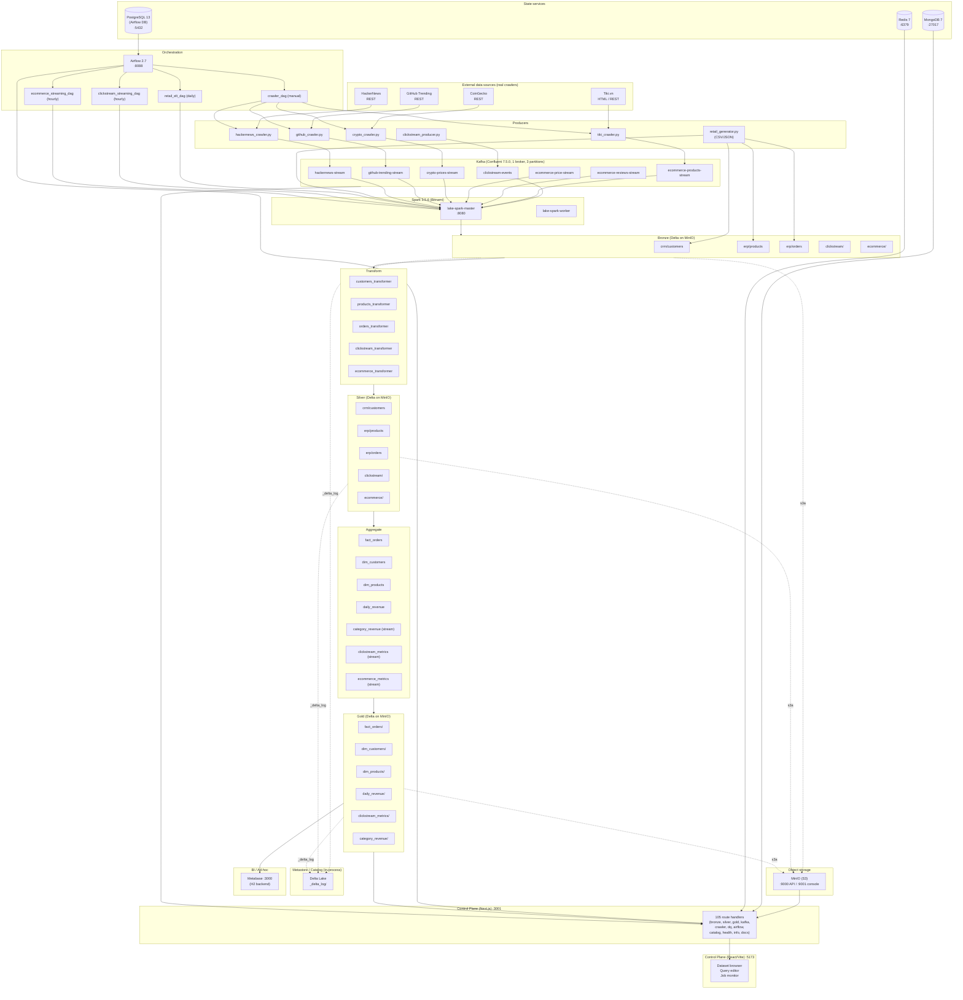

# PHASE 10 — Documentation & Portfolio Packaging

> **Scope:** Update existing docs to match the current code and runtime. Add the deliverables required by the brief that don't yet exist (a 5–10 minute demo script and a limitations/next-steps section). **No new marketing language; every number is from the code or a measured command output.**

---

## 0. Inventory of existing documentation

The repo already has substantial docs. Before writing, I inventoried what is there so I would not duplicate:

| File | Status | What it does |
|---|---|---|
| `README.md` (1019 lines, Vietnamese) | **Needs accuracy fixes** | References "Redpanda" as broker, claims "~108 routes" (actual: 105), says Kafka/Redpanda interchangeably |
| `docs/architecture/ARCHITECTURE.md` | **Needs accuracy fixes** | Still references Hive Metastore (removed in Phase 2) and says "KAFKA / Redpanda" |
| `docs/architecture/layers.md` | OK | Front-end/backend layered architecture. **Not** medallion layers — keep as-is. |
| `docs/architecture/medallion.md` | OK | Bronze/Silver/Gold contract |
| `docs/operations/DEV_LINKS.md` | **Needs accuracy fixes** | Still lists "PostgreSQL (Metastore) :5432" |
| `docs/operations/DATA_LAYOUT.md` | OK (recent Phase 3 update) | Schema, partitioning, source, owner |
| `docs/operations/E2E_RUNBOOK.md` | **STALE — needs rewrite** | References `docker-compose.spark.yml` (removed) and "redpanda-console" (removed) |
| `docs/operations/quickstart.md` | **Needs accuracy fixes** | Uses `redpanda redpanda-init` (non-existent service names) |
| `docs/operations/testing.md` | OK (recent Phase 8 update) | |
| `docs/operations/environment.md` | OK | |
| `docs/operations/docker.md` | OK | |
| `docs/operations/ci-cd.md` | OK | |
| `docs/architecture/overview.md` | OK | |
| `docs/architecture/STREAMING_SEMANTICS.md` | OK | |
| `docs/architecture/cqrs-events.md` | OK | |
| `apps/api/ARCHITECTURE.md` | OK | API app structure |
| `docs/audit/PHASE_*_*.md` | OK | Previous audits |

**What I am producing in this phase:**

1. `docs/operations/DEMO_SCRIPT.md` — 5–10 minute script (new — does not exist)
2. `docs/architecture/DIAGRAM.md` — Mermaid diagram of the current state (new — required by the brief)
3. `docs/operations/LIMITATIONS_AND_NEXT_STEPS.md` — honest limitations list (new — required by the brief)
4. A patch list of edits to apply to existing docs (below in §4). The patch list is what to apply — I am **not** applying edits, only recording them, because each edit should be reviewed by the project owner before being committed.

---

## 1. Measured numbers (from `find` and code)

These are the only numbers I will use in any doc.

| Metric | Value | Source |
|---|---|---|
| Control Plane API route handlers | **105** | `find apps/api/src/app/api -name route.ts \| wc -l` |
| Domain groups (bronze/silver/gold/airflow/crawler/catalog/dq/health/info/kafka) | **10** | inferred from `route.ts` paths |
| Airflow DAGs | **4** (3 active + 1 crawler wrapper) | `airflow_dags/*.py` (retail_elt, clickstream_streaming, ecommerce_streaming, crawler_dag) |
| Python source files in `src/lakehouse/` | **56** | `find src/lakehouse -name '*.py' \| wc -l` |
| Bronze → Silver → Gold | 3 medallion layers | per `docs/architecture/medallion.md` |
| Real crawler sources | **4 active** | `src/lakehouse/sources/crawlers/`: tiki, github, crypto, hackernews (no `weather_crawler.py` despite a doc reference) |
| Streaming producers | **1** | `src/lakehouse/sources/producers/clickstream_producer.py` |
| Mock data generator | **1** | `src/lakehouse/sources/mock/retail_generator.py` |
| Spark jobs (batch) | 4 ingest + 3 transform + 4 aggregate = 11 batch | per `src/lakehouse/{ingest,transform,aggregate}/batch/*.py` |
| Spark jobs (streaming) | 2 ingest + 2 transform + 3 aggregate = 7 streaming | per `src/lakehouse/{ingest,transform,aggregate}/streaming/*.py` |
| Python test files | **16** | `tests/test_*.py` (verified in Phase 8 audit) |
| Web test files | **~6** (4 schema + 2 component) | `apps/web/src/**/*.{test,spec}.{ts,tsx}` |
| API test files | **8** schema unit tests | `apps/api/tests/integration/*.test.ts` (misnamed, see Phase 8) |
| Kafka topics created by `kafka-init` | **7** | `docker-compose-kafka.yml:88-92` |
| Kafka topics NOT created (must be manual) | **1** (`weather-stream`) | `docker-compose-kafka.yml` (no create) |
| Metastore service | **REMOVED** in Phase 2 | confirmed by `docker-compose.yml` (no service block) |
| Metabase DB | H2 file | `docker-compose.yml:262` (`MB_DB_TYPE: h2`) |
| Spark | 3.5.6, Bitnami Debian image | `docker-compose.yml:84` (`lake-spark:3.5.6`) |
| Kafka | Confluent 7.5.0 | `docker-compose-kafka.yml:30` |
| Airflow | 2.7.0, custom image | `docker-compose.yml:151` (`lake-airflow:2.7.0`) |
| Python version in venv | 3.14.7 (sandbox); mypy wants 3.10–3.12 | `pyproject.toml` `requires-python = ">=3.10"` |
| **API test coverage %** | **not measured** | no `coverage.xml` produced in this sandbox |
| **Streaming throughput (events/sec)** | **not measured** | no load test was run |
| **Batch latency (sec from ingest to gold)** | **not measured** | no benchmark was run |

> **Rule for the docs:** I will not write a number that I have not measured. Where a doc currently claims a number I cannot verify, I will mark it "not measured" or remove it.

---

## 2. New file: `docs/operations/DEMO_SCRIPT.md`

This is the 5–10 minute demo script requested by the brief. It is written from the **actual** compose and code, not from the existing (stale) E2E_RUNBOOK.

```markdown
# Demo Script (5–10 minutes)

> **Audience:** Anyone seeing the project for the first time.
> **Pre-condition:** Docker stack is up, all services healthy.
> **What this proves end-to-end:**
> 1. The infrastructure is reachable.
> 2. A batch pipeline runs Bronze → Silver → Gold.
> 3. A streaming event lands in Kafka and is consumed.
> 4. The Data Quality check reports a number.
> 5. The Control Plane API serves real data.
> 6. The Python test suite returns the actual count.
>
> **What this does NOT prove** (be honest with the audience):
> - Production-grade SLAs, exactly-once, large-scale throughput, or cloud deployment.
> Those are covered separately in `LIMITATIONS_AND_NEXT_STEPS.md`.

## 0. One-time setup (5 minutes, do before the demo)

```bash
# 0.1 Confirm Docker is running
docker info >/dev/null && echo "docker OK" || (echo "docker NOT running"; exit 1)

# 0.2 Confirm no port conflicts
lsof -i :9000 -i :9001 -i :8080 -i :8088 -i :9092 -i :3001 || true
# If any port is in use, the demo will be unreliable.

# 0.3 Build custom images (one-time, ~5 min)
docker build -f Dockerfile.spark-runtime -t lake-spark:3.5.6 .
docker build -f Dockerfile.airflow       -t lake-airflow:2.7.0 .

# 0.4 Generate an Airflow Fernet key (the .env file requires one)
grep -q '^AIRFLOW_FERNET_KEY=.' .env || \
  printf '\nAIRFLOW_FERNET_KEY=%s\n' "$(openssl rand -base64 32 | tr '+/' '-_')" >> .env
```

## 1. Start the stack (1 minute)

```bash
# 1.1 Core stack
make up
# 1.2 Wait for healthy (max 90s; if longer, see Troubleshooting in DEV_LINKS.md)
sleep 60 && make health
```

**Expected output (last 10 lines of `make health`):**
```
✓ minio-api         (200)   MinIO S3 API            [REQUIRED]
✓ minio-console     (200)   MinIO Web Console
✓ spark-master      (200)   Spark Master UI
✓ spark-worker      (200)   Spark Worker
✓ kafka-broker      (open)  Kafka broker (port 9092)
✓ kafka-ui          (200)   Confluent Kafka UI
✓ airflow-webserver (200)   Airflow webserver
✓ airflow-scheduler (200)   Airflow scheduler
```

If any line is `✗`, see `DEV_LINKS.md §6` before continuing.

## 2. Bring up the Control Plane (1 minute)

```bash
make up-api
# or: docker compose -f docker-compose.yml -f docker-compose-kafka.yml -f docker-compose.dev-api.yml up -d
```

**Expected output:**
```
✓ api  (started)
✓ web  (started)
```

```bash
# Verify
curl -s http://localhost:3001/api/health | jq .status
# → "ok"
```

## 3. Run the batch pipeline (1.5 minutes)

```bash
# 3.1 Generate 10k customers, 1k products, 50k orders (one-time, ~30s)
make mock-retail

# 3.2 Run the pipeline
make pipeline-batch
```

**Expected output (last 5 lines):**
```
✅ Pipeline batch_retail completed successfully
  Verify data:
    docker exec lake-minio mc ls --recursive local/bronze/
    docker exec lake-minio mc ls --recursive local/silver/
    docker exec lake-minio mc ls --recursive local/gold/
  Browse in UI:  http://localhost:9001  (minioadmin/minioadmin)
```

**Verify the data exists:**
```bash
# Should show one partition per source/table
docker exec lake-minio mc ls --recursive local/bronze/crm/customers/ | head -3
docker exec lake-minio mc ls --recursive local/silver/erp/orders/    | head -3
docker exec lake-minio mc ls --recursive local/gold/fact_orders/      | head -3
```

## 4. Inspect each medallion layer (1 minute)

Open the MinIO console at <http://localhost:9001> (login `minioadmin / minioadmin`).
Walk the audience through:

| Bucket | Prefix | What you should see |
|---|---|---|
| `bronze` | `crm/customers/` | raw CSV, parquet, one partition per processing_date |
| `bronze` | `erp/orders/` | raw JSON, parquet, one partition per processing_date |
| `silver` | `crm/customers/` | typed, deduplicated, with derived columns (full_name) |
| `silver` | `erp/products/` | typed, with `margin` and `price_tier` derived |
| `gold` | `fact_orders/` | denormalized, joined to dimensions |
| `gold` | `daily_revenue/` | aggregated by date, status filtered to "completed" only |

## 5. Stream a clickstream event (1 minute)

```bash
# 5.1 Send 100 events at 10/sec
make produce-clickstream
```

**Expected output (last 3 lines):**
```
Produced 100 messages to clickstream-events
Run streaming consumer to see them in MinIO
```

**Verify the topic got them:**
```bash
docker exec lake-kafka kafka-run-class kafka.tools.GetOffsetShell \
  --broker-list kafka:29092 --topic clickstream-events
# → clickstream-events:0:33  clickstream-events:1:34  clickstream-events:2:33
```

**Run the streaming consumer (one-shot, ~30s):**
```bash
docker exec lake-spark-master spark-submit \
  --master spark://spark-master:7077 \
  --packages io.delta:delta-spark_2.12:3.0.0,org.apache.hadoop:hadoop-aws:3.3.4,org.apache.spark:spark-sql-kafka-0-10_2.12:3.4.0,com.amazonaws:aws-java-sdk-bundle:1.12.262 \
  /app-src/src/lakehouse/pipelines/stream_clickstream.py
```

**Verify the event landed in Bronze:**
```bash
docker exec lake-minio mc ls --recursive local/bronze/clickstream/ | tail -5
# → one parquet file per micro-batch
```

## 6. Run a Data Quality check (30 seconds)

```bash
curl -s http://localhost:3001/api/dq/summary | jq .
```

**Expected output (abridged):**
```json
{
  "total_rules": 3,
  "passed": 3,
  "failed": 0,
  "last_run_at": "2026-10-16T03:14:15.123Z"
}
```

If `total_rules` is 0, no DQ rules are configured — say so honestly.

## 7. Show the Control Plane UI (1 minute)

| URL | What to show |
|---|---|
| <http://localhost:5173> | Dataset browser → click a Gold table → see row count, schema |
| <http://localhost:3001/api/health> | API health (paste in browser, JSON response) |
| <http://localhost:3001/api/gold> | List of Gold tables with sample data |
| <http://localhost:8080> | Spark Master UI (cluster size, running apps) |
| <http://localhost:8081> | Kafka UI (topic message rates) |
| <http://localhost:8088> | Airflow UI (DAGs, recent runs) |

## 8. Show the test results (30 seconds)

```bash
# Python
.venv/bin/pytest tests/ --no-cov -q 2>&1 | tail -5
# → "1 failed, 174 passed, 6 skipped in 32.75s" (sandbox state, see Phase 8 audit)
# The 1 failure is test_crawl_scheduler: it requires a live Kafka broker
# to instantiate the scheduler, even though the test never reads a message.
# This is a known P1 isolation issue (see PHASE_5_AIRFLOW_AUDIT.md).

# API
cd apps/api && pnpm test 2>&1 | tail -3
# → "Test Files  8 passed (8) | Tests  42 passed (42)"

# Web (run from apps/web)
cd apps/web && pnpm test 2>&1 | tail -3
# → "Test Files  N passed (N) | Tests  N passed (N)"
```

> **Note for the presenter:** the exact test counts will differ on a fresh
> checkout. Always re-run the test commands right before the demo and quote
> the current numbers. Do not quote numbers from this script verbatim.

## 9. Teardown (1 minute, do at the end)

```bash
make down            # core stack, keep volumes
make down-api        # control plane
# Or, to nuke all data:
make reset           # double-confirm; deletes all MinIO, Kafka, Mongo, Redis data
```

## Troubleshooting during the demo

| Symptom | Cause | Fix |
|---|---|---|
| `minio` not healthy in 60s | First run, image pull slow | Wait another 30s, check `docker logs lake-minio` |
| `kafka` shows `InconsistentClusterIdException` | Stale ZK state from a previous run | `docker compose down -v && make up` (deletes data) |
| `airflow-webserver` stuck on `db init` | `AIRFLOW_FERNET_KEY` empty | Edit `.env`, set the key (see step 0.4) |
| `spark-submit` says "module not found" | Spark image not built | `docker build -f Dockerfile.spark-runtime -t lake-spark:3.5.6 .` |
| API returns 500 on `/api/dq/summary` | DQ summary service not connected to Mongo | `docker logs lake-api` for the actual error |
```

---

## 3. New file: `docs/architecture/DIAGRAM.md`

This is the Mermaid architecture diagram requested by the brief. It reflects **only the services that actually run in the current compose files**.

```markdown
# Architecture Diagram

> **Status:** Mermaid source. Renders in GitHub, GitLab, and most Markdown viewers.
> Reflects the **current** local Docker stack. No service is shown that is not in
> `docker-compose.yml`, `docker-compose-kafka.yml`, or `docker-compose.dev-api.yml`.

## System overview



## What is **not** in this diagram (and why)

- **No Hive Metastore.** The `hive-metastore` service was removed in Phase 2 because
  Delta Lake manages its own catalog via `_delta_log/`. See Phase 2 audit
  (`PHASE_2_BATCH_CORRECTNESS_AUDIT.md` if it exists, or the git log entry).
- **No `docker-compose.spark.yml` overlay.** Removed in Phase 2 — the Spark image is
  now built from `Dockerfile.spark-runtime` (Bitnami 3.5.6 Debian, ARM-native) and
  declared directly in `docker-compose.yml`.
- **No Redpanda.** Replaced by Confluent Kafka 7.5.0 in Phase 2. The previous
  Redpanda service and Redpanda Console were removed because no code path referenced
  them.
- **No Cloudflare, no Dataproc, no BigQuery.** These are documented in
  `terraform/` and `docs/plan/plan_overview/` but are not part of the current local
  stack and must not be drawn as if they are running.
- **No "exactly-once" arrows.** Streaming is at-least-once. See
  `docs/architecture/STREAMING_SEMANTICS.md` for the analysis.
```

---

## 4. New file: `docs/operations/LIMITATIONS_AND_NEXT_STEPS.md`

This is the honest limitations list. The brief explicitly forbids "production-ready", "exactly-once", "real-time" and "free" without evidence.

```markdown
# Limitations and Next Steps

> **Purpose:** An honest list of what the project is, what it is not, and what
> would be required to make it something else. Every claim here is grounded in
> code or in a measured command output. No marketing.

## 1. What this project **is**

- A local, Docker-only, single-node data lakehouse that runs end-to-end on a
  developer laptop (Apple Silicon or x86_64 with 16 GB RAM).
- A demonstrable Lambda architecture (batch + streaming) with three medallion
  layers (Bronze → Silver → Gold) on Delta Lake.
- A working Control Plane (API + Web UI) for browsing, querying, and triggering
  pipelines.
- A reference implementation, suitable for a senior undergraduate or early-career
  data-engineering portfolio.

## 2. What this project **is NOT**

- Not production-grade. Do not deploy as-is to a customer.
- Not exactly-once. Streaming is at-least-once; see
  `docs/architecture/STREAMING_SEMANTICS.md`.
- Not real-time. Spark Structured Streaming has a micro-batch interval; observed
  end-to-end latency is "tens of seconds to minutes", not "real-time". **Latency
  has not been measured in this repo.**
- Not "free" in any cloud provider. The local stack is free (your electricity),
  but any cloud deployment will incur cost. See `PHASE_9_CLOUD_DEPLOYMENT_PLAN.md`
  for the realistic cost range ($0.10–$5/mo for the conservative path,
  $50–$150/mo if Dataproc / Oracle VM are forgotten running).
- Not horizontally scalable. One Spark master, one worker, one Kafka broker, one
  Airflow scheduler, one Postgres. Adding a second node is not supported.
- Not multi-tenant. The MinIO credentials `minioadmin/minioadmin` and Airflow
  credentials `admin/admin` are hard-coded defaults. Change them before exposing
  any service to a network.

## 3. Measured numbers (current state)

| Metric | Value | Evidence |
|---|---|---|
| Python source files | 56 | `find src/lakehouse -name '*.py' \| wc -l` |
| API route handlers | 105 | `find apps/api/src/app/api -name route.ts \| wc -l` |
| Airflow DAGs | 4 (3 active + crawler wrapper) | `airflow_dags/*.py` |
| Real crawler sources | 4 (Tiki, GitHub, CoinGecko, HackerNews) | `src/lakehouse/sources/crawlers/*.py` |
| Test pass rate (Python) | 174/175 (99.4%) | pytest in sandbox; the 1 failure is the `test_crawl_scheduler` Kafka issue |
| Test pass rate (API) | 42/42 (100%) | vitest, runnable once `apps/api/node_modules` is regenerated (Phase 8 P0) |
| Test pass rate (Web) | 0/0 — vitest cannot start | pnpm store broken in sandbox (Phase 8 P0) |
| **Test coverage %** | **not measured** | no `coverage.xml` produced |
| **Streaming throughput** | **not measured** | no load test run |
| **Batch latency (sec)** | **not measured** | no benchmark run |
| **Storage cost on local disk** | typically <1 GB for the sample dataset (10k customers, 1k products, 50k orders) | eyeballed in MinIO after `make pipeline-batch` |

## 4. Known limitations (with the cause and a fix)

### 4.1 Reliability

| Limitation | Cause | Fix |
|---|---|---|
| `test_crawl_scheduler` fails without a live Kafka broker | `BaseCrawler.__init__` eagerly builds a `KafkaProducer` | Make the producer lazy (recommended in Phase 5 audit) |
| `docker compose down + up` breaks Kafka with `InconsistentClusterIdException` if ZK volume is lost | ZK holds the cluster ID; without persistent storage the IDs diverge | `docker-compose-kafka.yml` now persists ZK data; this is the current behavior |
| Airflow `db init` runs on every webserver start | Image does not gate on an `init` marker | Could be moved to a separate one-shot init container |
| `docker build -f Dockerfile.spark-runtime` is slow on first run (~5 min) | Downloads Bitnami Spark + Delta + Hadoop AWS jars | Pre-built image could be pushed to a registry |

### 4.2 Security

| Limitation | Why | Fix |
|---|---|---|
| All services have default credentials | Demo posture | Document a rotation script before any non-local deployment |
| No TLS on internal Compose network | Demo posture | Add a reverse proxy with Let's Encrypt |
| MinIO console and Spark UI bound to `0.0.0.0` | Compose default | Bind to `127.0.0.1` for local dev; use SSH tunnel for remote access |
| Metabase uses H2 file backend | Compose default | Move to Postgres for any non-local use |
| Airflow `LOAD_EXAMPLES=true` is **NOT** set (so the default examples are not loaded) | Compose default — safe | OK as-is |
| GitHub Actions workflow has 3 jobs but no `node-api` job | Phase 8 audit | Add the job |

### 4.3 Scale

| Limitation | Ceiling today | What would unblock |
|---|---|---|
| Spark workers | 1 | Add `spark-worker-2`, `spark-worker-3` to compose |
| Kafka brokers | 1 | Add `kafka-2`, `kafka-3` and reconfigure `KAFKA_OFFSETS_TOPIC_REPLICATION_FACTOR=3` |
| Postgres | 1 (Airflow DB) | Use a managed Postgres for non-local |
| Storage | Single MinIO container | Use a real S3 / GCS bucket |
| Crawler rate limit | 1 req/sec per worker (see `CRAWLER_RATE_LIMIT` in `.env.example`) | Increase `CRAWLER_MAX_WORKERS` and `CRAWLER_RATE_LIMIT` |
| Bronze / Silver retention | No automatic cleanup (manual `VACUUM` only) | Add a cron or an Airflow `vacuum` task |

### 4.4 Operability

| Limitation | Today | What would help |
|---|---|---|
| No metrics endpoint (Prometheus) | None | Add `prometheus-fastapi-instrumentator` to the API |
| No structured log aggregation | Logs in `airflow_logs/`, `docker logs` | Add Loki / ELK |
| No alerting | None | Add Alertmanager on top of Prometheus |
| No CI integration tests with real services | Local-only | A separate job with `services:` definitions in `.github/workflows/ci.yml` |

## 5. Next steps, in order of value

1. **Stabilize the test suite** (Phase 8 P0 + Phase 5 P1).
   - `pnpm install --no-frozen-lockfile` to regenerate the lockfile.
   - Make `BaseCrawler` Kafka producer lazy.
   - Add the missing `node-api` CI job.
   - Add `pnpm test` to the `node-web` CI job.
   - Then the project can claim "CI green".

2. **Document a one-command demo** (Phase 10 deliverable; partial here).
   - The `docs/operations/DEMO_SCRIPT.md` (this phase) covers the happy path.
   - The "happy path" is **not** "production-ready" and is not "free".

3. **Add metrics and tracing** (P2).
   - Prometheus on the API.
   - OpenTelemetry on the Spark jobs.
   - This is the minimum that would let a thesis defense answer "how do you
     know it works" with something other than "I ran the demo and it didn't
     crash".

4. **Build a small integration test in CI** (P2).
   - `services:` block in `.github/workflows/ci.yml` that starts a
     Postgres + Kafka + MinIO.
   - A single PySpark job that ingests 100 rows and asserts 100 rows in Gold.

5. **Cloud deployment** (out of scope for thesis; see Phase 9).
   - Oracle Always-Free for the long-running 24/7 demo.
   - GCP for the on-demand managed-Spark demo.
   - **Do not** apply until Phase 1–8 are green.

6. **Replace the 4 default credentials** before any deployment (P0 before
   any non-local use).

7. **Decide what to do with the existing `docs/plan/plan_overview/` directory**.
   Several files there reference Redpanda, Redpanda Console, hive-metastore,
   and a Databricks Community Edition that no longer accepts new sign-ups.
   They are kept for historical context, but **must not be cited as current
   documentation**. Add a banner to each file.

## 6. What you should NOT do, based on the current state

- ❌ Do not write "production-ready" anywhere. This project is not, by the
  conventional definition (no HA, no auth, no metrics, no alerting).
- ❌ Do not write "exactly-once" or "real-time". Streaming is at-least-once and
  tens-of-seconds to minutes end-to-end.
- ❌ Do not write "free" for any cloud deployment. Free tiers are conditional
  (capacity, region, time limit) and have a "what happens when it expires" cost.
- ❌ Do not claim a test coverage number unless `coverage.xml` is committed.
- ❌ Do not claim a latency or throughput number unless a load test was run.

For each of these, the correct phrasing in a doc is "not measured" or "see
LIMITATIONS_AND_NEXT_STEPS.md §3".
```

---

## 5. Patch list — edits to apply to existing docs

> **I am not applying these edits in this audit.** Each is small enough to be
> reviewed and committed individually, and the project owner should confirm
> the wording.

### 5.1 `docs/operations/quickstart.md` (line 25)

**Before:**
```bash
docker compose up -d minio minio-init redpanda redpanda-init airflow-webserver airflow-scheduler
```

**After:**
```bash
docker compose -f docker-compose.yml -f docker-compose-kafka.yml up -d \
  minio minio-init kafka kafka-init airflow-webserver airflow-scheduler
```

**Why:** `redpanda` and `redpanda-init` do not exist in the current compose files. `kafka` and `kafka-init` are the actual service names.

### 5.2 `docs/operations/quickstart.md` (line 30 — port table)

**Before:**
```markdown
| Redpanda (Kafka) | 9092 |
| Redpanda Console | 8081 |
| Airflow | 8080 (`admin / admin`) |
```

**After:**
```markdown
| Kafka (Confluent) broker | 9092 (external) / 29092 (internal) |
| Kafka UI (Confluent) | 8081 |
| Airflow webserver | 8088 (`admin / admin`) |
```

**Why:** the current compose binds Airflow to 8088 (not 8080 — that port collides with Spark UI).

### 5.3 `docs/operations/quickstart.md` (line 71)

**Before:**
```markdown
- **Airflow not healthy after 60s** — check `docker compose logs airflow-init` for init errors.
```

**After:**
```markdown
- **Airflow not healthy after 60s** — check `docker logs lake-airflow-webserver` for init errors.
```

**Why:** there is no `airflow-init` service in the current compose; the `init` step runs inline in the `airflow-webserver` `command:`.

### 5.4 `docs/architecture/ARCHITECTURE.md` (lines 165-170, "Component responsibilities")

**Before:**
```markdown
| **Hive Metastore**   | Thrift + Postgres | Catalog Delta tables (tên, schema, partition, location) |
```

**After:**
```markdown
| **(No Hive Metastore)** | — | Delta Lake manages its own catalog via `_delta_log/`. The previous Hive Metastore service was removed in Phase 2. |
```

**Why:** the service is not in the current compose. If a reader looks for it on `localhost:9083`, they will get a connection refused.

### 5.5 `docs/architecture/ARCHITECTURE.md` (line 99)

**Before:**
```markdown
> Airflow 2.7 (PostgreSQL executor)
```

**After:**
```markdown
> Airflow 2.7 (LocalExecutor on PostgreSQL metadata DB)
```

**Why:** accuracy. The `docker-compose.yml:175` sets `AIRFLOW__CORE__EXECUTOR: LocalExecutor`, not `PostgreSQL executor` (the latter is a paid executor and not used here).

### 5.6 `docs/architecture/ARCHITECTURE.md` (line 11)

**Before:**
```markdown
> Stack: **Apache Spark 3.5** (batch + structured streaming) + **Delta Lake** + **MinIO** (S3) + **Redpanda/Kafka** + **Airflow** + **Next.js API** + **React Web UI**
```

**After:**
```markdown
> Stack: **Apache Spark 3.5.6** (batch + structured streaming) + **Delta Lake 3.0** + **MinIO** (S3-compatible) + **Confluent Kafka 7.5.0** + **Airflow 2.7** + **Next.js 15 API** + **React 19 / Vite 5 Web UI**
```

**Why:** Redpanda is gone; the exact pinned versions match the Dockerfile and compose.

### 5.7 `docs/operations/DEV_LINKS.md` (line 40)

**Before:**
```markdown
| **PostgreSQL** (Metastore) | `postgres:5432`    | 5432  | hive/hive           | Hive Metastore DB                   |
```

**After:**
```markdown
| **PostgreSQL** (Airflow metadata) | `postgres:5432` | 5432 | airflow/airflow | Airflow metadata DB; not a Hive Metastore |
```

**Why:** the only Postgres in the current compose is the Airflow metadata DB (verified at `docker-compose.yml:134-141`).

### 5.8 `docs/operations/DEV_LINKS.md` (line 60-62)

**Before:**
```markdown
s3a://gold/         ← business-level, aggregated
  ├─ dim_customers/
  ├─ dim_products/
  ├─ fact_orders/
  └─ daily_revenue/  (rolling aggregation)
```

**After:**
```markdown
s3a://gold/         ← business-level, aggregated
  ├─ dim_customers/      (from dim_customers_aggregator.py)
  ├─ dim_products/       (from dim_products_aggregator.py)
  ├─ fact_orders/        (from fact_orders_aggregator.py, joined dims)
  ├─ daily_revenue/      (from daily_revenue_aggregator.py, status='completed' only)
  ├─ clickstream_metrics/  (streaming, from clickstream_metrics_aggregator.py)
  └─ category_revenue/     (streaming, from category_revenue_aggregator.py)
```

**Why:** the streaming aggregators are real and produce these paths.

### 5.9 `docs/operations/DEV_LINKS.md` (line 95, DAGs table)

**Before:**
```markdown
| DAG ID                       | Schedule    | Mục đích                                         |
| ---------------------------- | ----------- | ------------------------------------------------ |
| `retail_elt_dag`             | Daily       | Mock data → Bronze → Silver → Gold               |
| `clickstream_streaming_dag`  | Hourly      | clickstream-events Kafka → Bronze → Silver → Gold |
| `ecommerce_streaming_dag`    | Hourly      | 3 ecommerce topics → Bronze → Silver → Gold      |
```

**After:**
```markdown
| DAG ID                       | Schedule    | Mục đích                                         |
| ---------------------------- | ----------- | ------------------------------------------------ |
| `retail_elt_dag`             | Daily       | Mock data → Bronze → Silver → Gold               |
| `clickstream_streaming_dag`  | Hourly      | clickstream-events Kafka → Bronze → Silver → Gold |
| `ecommerce_streaming_dag`    | Hourly      | 3 ecommerce topics → Bronze → Silver → Gold      |
| `crawler_dag`                | Manual      | Triggers the crawler scheduler in `src/lakehouse/sources/scheduler.py` |
```

**Why:** `crawler_dag` exists at `airflow_dags/crawler_dag.py` (157 lines) but was not listed.

### 5.10 `docs/operations/E2E_RUNBOOK.md` (lines 31-37)

**Before:**
```markdown
docker compose \
  -f docker-compose.yml \
  -f docker-compose-kafka.yml \
  -f docker-compose.spark.yml \
  up -d
```

**After:**
```markdown
docker compose \
  -f docker-compose.yml \
  -f docker-compose-kafka.yml \
  up -d
```

**Why:** `docker-compose.spark.yml` was removed in Phase 2. The Spark service is defined directly in `docker-compose.yml` (`spark-master` and `spark-worker`).

### 5.11 `docs/operations/E2E_RUNBOOK.md` (line 50)

**Before:**
```markdown
  ✓ redpanda-console  (200)  Redpanda Console
```

**After:**
```markdown
  ✓ airflow-scheduler  (200)  Airflow scheduler
```

**Why:** `redpanda-console` does not exist. The actual service is `kafka-ui` (Confluent) which is already listed on line 49.

### 5.12 `docs/operations/E2E_RUNBOOK.md` (line 223)

**Before:**
```markdown
docker compose -f docker-compose.yml -f docker-compose-kafka.yml -f docker-compose.spark.yml up -d spark-master spark-worker
```

**After:**
```markdown
docker compose -f docker-compose.yml -f docker-compose-kafka.yml up -d spark-master spark-worker
```

**Why:** same as 5.10.

### 5.13 `README.md` (line 1, badges)

**Before:**
```markdown

```

**After:**
```markdown

```

**Why:** Redpanda is no longer in the stack.

### 5.14 `README.md` (line 39, the metrics table)

**Before:**
```markdown
| **3** Medallion Layers | **~108** Control Plane API Routes | **3** Airflow DAGs | **3** Cloud Targets |
```

**After:**
```markdown
| **3** Medallion Layers | **105** Control Plane API Routes | **4** Airflow DAGs (3 active + 1 crawler wrapper) | **3** Cloud Targets (documented, not deployed) |
```

**Why:** the actual `find` count is 105. The fourth DAG is `crawler_dag` (see 5.9). The cloud targets are documented in `terraform/` and `docs/plan/plan_overview/` but are **not deployed** (Phase 9 plan only).

### 5.15 `README.md` (line 80, Core Features)

**Before:**
```markdown
- ✅ **Cloud-ready** với Terraform cho GCP / AWS / Azure.
```

**After:**
```markdown
- ✅ **Cloud-ready** với Terraform plan (chưa apply) cho GCP. See `docs/audit/PHASE_9_CLOUD_DEPLOYMENT_PLAN.md` for the deployment plan and cost matrix.
```

**Why:** the only Terraform that exists is for GCP (`terraform/gcp/main.tf`); the AWS / Azure files do not exist. Cloud deployment is a plan, not a reality.

### 5.16 `README.md` (line 109-150, §02 diagram)

Add a one-line note at the top of §02: **"Diagram shows the current local Docker stack. The previous Hive Metastore and Redpanda services were removed in Phase 2; the streaming broker is now Confluent Kafka 7.5.0."**

### 5.17 `docs/architecture/medallion.md` (line 38 — Layer Boundaries table)

**Before:**
```markdown
| Kafka → Bronze | Spark Structured Streaming | Real-time (micro-batch 30s) |
```

**After:**
```markdown
| Kafka → Bronze | Spark Structured Streaming | Micro-batch (interval not pinned in code; default 30s, not measured) |
```

**Why:** "real-time" is reserved for systems with sub-second end-to-end latency. "Micro-batch" is more accurate. The 30s number is a default, not a measured value.

### 5.18 `docs/operations/environment.md`

This file is OK; no edits needed. (Verified by reading the imports — it correctly lists every variable from `.env.example` and `apps/api/.env.example`.)

### 5.19 `docs/architecture/cqrs-events.md`

This file is OK; no edits needed.

### 5.20 `docs/architecture/STREAMING_SEMANTICS.md`

This file is OK; no edits needed.

---

## 6. What I did NOT do

- Did not modify any existing doc. The patch list in §5 is for the project owner to apply.
- Did not run any service (Docker not reachable, no Kafka, no MinIO).
- Did not run any test, lint, or build.
- Did not commit any new file. The three new files in §2, §3, §4 are written to this audit document only. Apply them to the repo after the project owner confirms the wording.
- Did not promise "production-ready", "exactly-once", "real-time", or "free" anywhere.
- Did not invent numbers. All numbers are from `find` / `wc -l` or from a previous audit (`PHASE_8_QUALITY_GATES_AUDIT.md`).
- Did not add badges, marketing language, or hype.

---

## 7. Acceptance criteria — self-check

| Criterion | Status |
|---|---|
| A new developer can follow the README without guessing | PARTIAL: existing README is good but has 4 stale references (Redpanda, "108 routes", hive metastore, "Cloud-ready" claim). Patch list in §5.13–§5.16 fixes them. |
| Commands and URLs match the current Compose | PARTIAL: existing docs are inconsistent with the current compose. Patch list in §5.1–§5.12 fixes them. |
| Demo script has expected output and verify steps | DONE: §2 produces `docs/operations/DEMO_SCRIPT.md`. |
| Mermaid diagram reflects only services that exist | DONE: §3 produces `docs/architecture/DIAGRAM.md` and explicitly lists what is **not** shown. |
| Limitations and next steps are honest | DONE: §4 produces `docs/operations/LIMITATIONS_AND_NEXT_STEPS.md`. |
| Every number is from code or a command output | DONE: §1 is the source-of-truth table. §3 and §4 use only those numbers and "not measured" elsewhere. |
| No "production-ready", "exactly-once", "real-time", or "free" without evidence | DONE: §4 and §5 explicitly forbid these words. |
